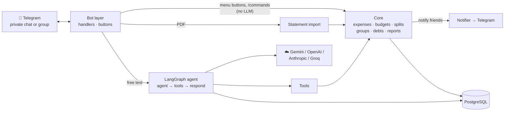

# Expense Tracker: chat-based expenses and bill splitting on Telegram

Tell the bot what you spent, in plain words. It keeps your expenses, warns you about budgets, and splits bills with
friends and trip groups, Splitwise style, all inside Telegram.

There are **no bank or cash accounts**: "spent 300 on ice cream" simply adds ₹300 to your expenses.

## What it does

| | |
|---|---|
| 🔴 **Expenses** | "spent 300 on ice cream", "paid 1200 for petrol yesterday". Any phrasing, any language. Undo any entry. |
| 🎯 **Budgets** | "set a limit of 3k for food". Alerts at 50%, 80% and 100%, once per month per threshold. |
| 📊 **Reports** | Summary by category, any month / day / range, month-by-month trend, day-by-day view, with ◀ ▶ month buttons. |
| 📄 **Statement import** | Send a bank-statement PDF: spending rows become expenses after you confirm (credits and ATM withdrawals are skipped). |
| 👥 **Friends** | "add friend Surya 123456789" (nickname + Telegram id), or `/invite` for a link they just tap. |
| 💸 **Split a bill** | "dinner 3000, split equally with Surya, Ravi and Anil". Everyone is told what they owe. |
| 🧳 **Group chats** | Add the bot to a Telegram group: it sets itself up. Anyone mentions it to add expenses, then "split the bill" posts who owes what and DMs each person their bill. |

### Splitting a bill
1. You say: *"went to dining, paid 3k, split equally with Surya, Ravi, Anil"* (you are included: ₹750 each).
2. If you didn't say how to split, the bot **asks** with buttons: *Equally* / *I'll tell the amounts*.
   With 4+ people it first asks: *one-off split* or *create a group*.
3. **Your** ₹750 is saved as your expense. Each friend gets a private message: *"Kiran paid for dining. Your share: ₹750. [✅ I paid]"*
4. A friend taps **I paid**: the message disappears and their ₹750 is logged in **their** expenses.
   The person owed gets *"Surya says he paid ₹750. [✅ Received] [✖ Not yet]"*.
   **Received** settles it; **Not yet** puts it back on his list and removes the expense again.
5. Unpaid shares are re-sent every 48 hours (`REMINDER_EVERY_HOURS`). `/dues` shows who owes whom.

### Several bills, different payers (a party night)
*"I paid 2500 for food, Surya paid 600 for ice cream and Komal paid 3500 for the bar. Who pays whom?"*
The bot takes all the bills **at once**, shares the ₹6,600 equally (₹2,200 each) and nets everyone's paid-vs-share, so you get the
**fewest payments** instead of one per bill. The reply first says **who pays whom**, then shows each person's maths
(*owes = share − paid*) with the bills behind it, so anyone can check it:
```
💸 Who pays whom
• surya → Komal Kumar  ₹1,300
• surya → You  ₹300

📋 Each person  (owes = share − paid)
• surya owes ₹1,600
   (share ₹2,200: party food ₹833.33, ice cream ₹200, bar ₹1,166.67 · paid ₹600: ice cream ₹600)
• Komal Kumar gets back ₹1,300
   (share ₹2,200: ... · paid ₹3,500: bar ₹3,500)
• You get back ₹300
   (share ₹2,200: ... · paid ₹2,500: party food ₹2,500)
```
Each person also gets their own bill privately (whom to pay, the same items, and an **I paid** button); people owed money are told what
they'll receive, and your own ₹2,200 is saved to your expenses. A person who owes two people records their share once, on their first
payment. The odd paise are spread across bills so amounts stay clean. Group settle-up (`/settle`) uses the same format.

### Group chats (trips, flatmates, any outing)
1. **You create a Telegram group, add your friends, and add the bot.** That's the whole setup: the bot makes the expense group
   by itself (named after the chat) and posts a short welcome. There is no `/creategroup`, no `/join`, no button to press.
2. **Anyone in the group can use it, friends of yours or not**, by **mentioning the bot**:
   - `@bot I paid 1000 for petrol`
   - `@bot Surya paid 600 for ice cream`
   - `@bot paid 900 for the cab, split between me and Surya`
   - the whole outing at once: `@bot I paid 2500 for food, Surya 600 for ice cream, Komal 3500 for the bar, split it`
   If the split isn't stated the bot **asks**: *Equally* / *Always equally in this group* / *I'll tell the amounts*.
3. `@bot split the bill` (or `/settle`) asks for confirmation, then posts in the group **who pays whom** and **each person's maths with
   the bills behind it**, as above. Each person also gets their own bill privately, with the same items and an **I paid** button.
   People who owe nothing are told what they're owed; shares are saved to everyone's own expenses.
4. Debtors tap **I paid**, the person owed taps **Received** (or **Not yet**), exactly as in a one-off split.

**Who counts as a member.** A bot cannot list a group's members, so it learns them from: the person who added it, "X joined" notices
(people who leave are left out of future splits), your friends who are in the chat (checked once when it's added; this is only
guaranteed if the bot is a group admin), and **anyone who mentions it**. Before a split it compares its list with Telegram's member count
and says *"I only know 3 of the 5 people, the others should mention me once"* so nobody is left out silently.

**Access.** Everyone in a group the owner added the bot to can use it, in the group and in their private chat with it. If a stranger
adds the bot to some other group, it leaves. Group members cannot add the bot to further groups.

> **Telegram limits to know:**
> - A bot can only message people who pressed **Start** on it once. If someone owes money and hasn't, the bot **tags them in the group
>   with a Start button** and their bill arrives the moment they press it.
> - Bots can't create groups or add members: you do that part.
> - In groups the bot only reacts to an **@mention**, a reply to its message, or a `/command`. Keep BotFather's **privacy mode ON**
>   (the default): then Telegram doesn't even deliver ordinary messages, so it can't read your friends' chat.

## Architecture



| Folder | Role |
|---|---|
| `app/core/` | **All the logic, no LLM, no Telegram.** `expenses`, `budgets`, `reports`/`views`, `friends`, `splits` (shares to the paisa), `groups` (settle-up), `debts` (pay / confirm lifecycle), `notices` (every message to other people), `statements` |
| `app/tools/` | What the LLM may call. Private chat and group chat get different tool sets |
| `app/agent/` | LangGraph graph, runner (pause/resume), prompt, scope guardrails, LLM factory, statement parser |
| `app/bot/` | Telegram: private chat, group chat, payment buttons, statement upload, reminders, notifier |
| `app/db/` | SQLAlchemy models and sessions |

### How a message flows
`agent` asks the LLM which tools to call → `tools` runs them **one per step** → `respond` builds the reply from the tool output
(no second LLM call). The LLM never writes text to the user; anything off-topic gets a fixed refusal. If something is missing
(*how to split?*, *one-off or group?*, *settle now?*) a tool pauses the graph with `interrupt()` and the bot shows buttons;
the pause is saved in Postgres so it survives restarts.

### Data
`users`, `friends` (nicknames are private to each owner), `expenses` (never deleted, undo = `voided_at`), `budgets`, `budget_alerts`,
`groups`, `group_members` (with `left_at`), `shared_expenses` + `shares` (who owes how much), `debts` (pending → claimed → settled), `statement_imports`.

## Run

1. Telegram: @BotFather → `/newbot` → copy the token (the **whole** token, `123456789:AAE...`). Your id: @userinfobot.
2. `cp .env.example .env` and fill `TELEGRAM_BOT_TOKEN`, `LLM_API_KEY`, `ALLOWED_TELEGRAM_IDS`.
3. **Docker (recommended):** `docker compose up --build`. This uses a **new database** (`expense_tracker`, volume `pgdata_expense`);
   the earlier cash/bank data in the old `pgdata` volume is untouched (delete it with `docker volume rm` when you no longer need it).

**Local:** Python 3.12, a Postgres, then `pip install -r requirements.txt` and `python run.py` (not plain uvicorn on Windows: see `run.py`).

**Production:** `TELEGRAM_MODE=webhook`, `PUBLIC_URL=https://your.domain`, a strong `TELEGRAM_WEBHOOK_SECRET`.

`ALLOWED_TELEGRAM_IDS` limits who can start using the bot; anyone you add as a friend (or who opens your invite link) can use it too.

## Limits
- Friends must press Start before they can be messaged.
- A tool call can't depend on another tool's result in the same message (the AI picks all tools up front).
- Free LLM tiers are rate limited per minute; the bot says so instead of hanging.
- Locks are per process: run a single instance. No migration tool yet (tables are created at startup).
- The `.pptx` files in `docs/` still describe the earlier cash/bank version.

## More documentation
- 🏗️ [Architecture](docs/ARCHITECTURE.md): system overview, layers, chat contexts, agent graph, data model, deployment, safety
- 🔀 [Flows](docs/FLOWS.md): routing, expenses, splitting, the payment lifecycle, party netting, group setup and settle-up, statements, budgets
- 🧠 [State graph](docs/STATE_GRAPH.md): how the agent loops (agent → tools → respond), with real traces and every possible path
