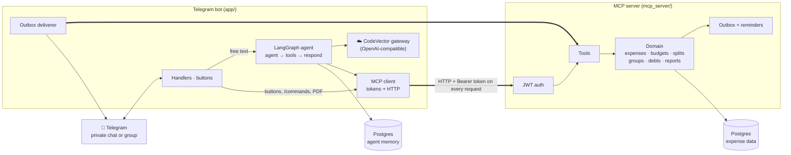

# Expense Tracker: chat-based expenses and bill splitting on Telegram

Tell the bot what you spent, in plain words. It keeps your expenses, warns you about budgets, and splits bills with
friends and trip groups, Splitwise style, all inside Telegram.

There are **no bank or cash accounts**: "spent 300 on ice cream" simply adds ₹300 to your expenses.

## What it does

| | |
|---|---|
| 🔴 **Expenses** | "spent 300 on ice cream", "paid 1200 for petrol yesterday". Any phrasing, any language. Undo any entry. |
| 🎯 **Budgets** | "set a limit of 3k for food". Alerts at 50%, 80% and 100%, once per month per threshold. |
| 📊 **Reports** | Summary by category, any month / day / range, month-by-month trend, day-by-day view, with ◀ ▶ month buttons. |
| 📄 **Statement import** | Send a bank-statement PDF: spending rows become expenses after you confirm (credits and ATM withdrawals are skipped). |
| 👥 **Friends** | "add friend Surya 123456789" (nickname + Telegram id), or `/invite` for a link they just tap. |
| 💸 **Split a bill** | "dinner 3000, split equally with Surya, Ravi and Anil". Everyone is told what they owe. |
| 💳 **Dues** | `/dues`: one total per person (not one line per bill), with **✅ I paid** / **✅ Received** buttons. What two friends owe each other cancels out automatically. Pay only part: "I paid Surya 300". |
| 🧳 **Group chats** | Add the bot to a Telegram group: it sets itself up. Anyone mentions it to add expenses, then "split the bill" posts who owes what and DMs each person their bill. |

### Splitting a bill
1. You say: *"went to dining, paid 3k, split equally with Surya, Ravi, Anil"* (you are included: ₹750 each).
2. If you didn't say how to split, the bot **asks** with buttons: *Equally* / *I'll tell the amounts*.
   With 4+ people it first asks: *one-off split* or *create a group*.
3. **Your** ₹750 is saved as your expense. Each friend gets a private message: *"Kiran paid for dining. Your share: ₹750. [✅ I paid]"*
4. A friend taps **I paid**: the message disappears and their ₹750 is logged in **their** expenses.
   The person owed gets *"Surya says he paid ₹750. [✅ Received] [✖ Not yet]"*.
   **Received** settles it; **Not yet** puts it back on his list and removes the expense again.
5. Unpaid shares are re-sent every 48 hours (`REMINDER_EVERY_HOURS`). `/dues` shows who owes whom.

**Splitting something you just logged.** "I paid 500 for petrol", then "split it with Surya": the plain ₹500 expense is replaced by the
split (your ₹250 share), so the petrol is not counted twice. This only happens for the same amount, logged within the last hour.

### Dues, paying and netting
- **One total per person.** `/dues` shows *"You owe Surya ₹350"*, not a line per tea or pizza. Under it: **✅ I paid Surya ₹350**.
  For money owed to you that was marked paid: **✅ Received from Surya ₹350** and **✖ Not yet**. The message edits in place.
- **Opposite debts cancel.** If Surya owes you ₹50 and you owe him ₹50, both are settled automatically and both of you get a
  *"🔁 netted off"* message. Both people's own shares stay in their expenses. Netting runs when a new split is made and again whenever
  `/dues` is opened. Debts already marked "paid" are in flight and left alone.
- **Pay part of it.** *"I paid Surya 300"* takes exactly ₹300 off, oldest bill first (a bigger bill is cut in two). The rest stays due,
  and Surya is asked to confirm **Received** or **Not yet**. *"Not yet"* puts back only that part. No amount (*"paid Ravi back"*) means everything.
- A netted split can no longer be cancelled with the **Cancel split** button.

## Commands
Type `/` in Telegram to see them. There is no permanent keyboard under the text box.

| Private chat | |
|---|---|
| `/summary` | Spending summary with ◀ ▶ month buttons |
| `/history` | Recent expenses (`/recent` works too) |
| `/budgets` | Budget progress |
| `/daily` · `/trend` | Day-by-day and month-by-month spending |
| `/friends` · `/invite` | Your friends; your invite link |
| `/dues` | Who owes whom, with the pay buttons |
| `/undo` · `/help` | Undo the last expense; what you can say |

| Group chat | |
|---|---|
| `/settle` | Settle up the group (asks first) |
| `/people` | Who the bot knows in this group |
| `/summary` | Who paid what and who is owed (`/group` works too) |
| `/help` | How to use the bot here |

### Several bills, different payers (a party night)
*"I paid 2500 for food, Surya paid 600 for ice cream and Komal paid 3500 for the bar. Who pays whom?"*
The bot takes all the bills **at once**, shares the ₹6,600 equally (₹2,200 each) and nets everyone's paid-vs-share, so you get the
**fewest payments** instead of one per bill. The reply first says **who pays whom**, then shows each person's maths
(*owes = share − paid*) with the bills behind it, so anyone can check it:
```
💸 Who pays whom
• surya → Komal Kumar  ₹1,300
• surya → You  ₹300

📋 Each person  (owes = share − paid)
• surya owes ₹1,600
   (share ₹2,200: party food ₹833.33, ice cream ₹200, bar ₹1,166.67 · paid ₹600: ice cream ₹600)
• Komal Kumar gets back ₹1,300
   (share ₹2,200: ... · paid ₹3,500: bar ₹3,500)
• You get back ₹300
   (share ₹2,200: ... · paid ₹2,500: party food ₹2,500)
```
Each person also gets their own bill privately (whom to pay, the same items, and an **I paid** button); people owed money are told what
they'll receive, and your own ₹2,200 is saved to your expenses. A person who owes two people records their share once, on their first
payment. The odd paise are spread across bills so amounts stay clean. Group settle-up (`/settle`) uses the same format.

### Group chats (trips, flatmates, any outing)
1. **You create a Telegram group, add your friends, and add the bot.** That's the whole setup: the bot makes the expense group
   by itself (named after the chat) and posts a short welcome. There is no `/creategroup`, no `/join`, no button to press.
2. **Anyone in the group can use it, friends of yours or not**, by **mentioning the bot**:
   - `@bot I paid 1000 for petrol`
   - `@bot Surya paid 600 for ice cream`
   - `@bot paid 900 for the cab, split between me and Surya`
   - the whole outing at once: `@bot I paid 2500 for food, Surya 600 for ice cream, Komal 3500 for the bar, split it`
   If the split isn't stated the bot **asks**: *Equally* / *Always equally in this group* / *I'll tell the amounts*.
3. `@bot split the bill` (or `/settle`) asks for confirmation, then posts in the group **who pays whom** and **each person's maths with
   the bills behind it**, as above. Each person also gets their own bill privately, with the same items and an **I paid** button.
   People who owe nothing are told what they're owed; shares are saved to everyone's own expenses.
4. Debtors tap **I paid**, the person owed taps **Received** (or **Not yet**), exactly as in a one-off split.

**Who counts as a member.** A bot cannot list a group's members, so it learns them from: the person who added it, "X joined" notices
(people who leave are left out of future splits), your friends who are in the chat (checked once when it's added; this is only
guaranteed if the bot is a group admin), and **anyone who mentions it**. Before a split it compares its list with Telegram's member count
and says *"I only know 3 of the 5 people, the others should mention me once"* so nobody is left out silently.

**Access.** Everyone in a group the owner added the bot to can use it, in the group and in their private chat with it. If a stranger
adds the bot to some other group, it leaves. Group members cannot add the bot to further groups.

> **Telegram limits to know:**
> - A bot can only message people who pressed **Start** on it once. If someone owes money and hasn't, the bot **tags them in the group
>   with a Start button** and their bill arrives the moment they press it.
> - Bots can't create groups or add members: you do that part.
> - In groups the bot only reacts to an **@mention**, a reply to its message, or a `/command`. Keep BotFather's **privacy mode ON**
>   (the default): then Telegram doesn't even deliver ordinary messages, so it can't read your friends' chat.

## Architecture

Two services that only talk over HTTP. The **MCP server** owns the tools, the logic, the database and the authentication; the **Telegram bot**
owns Telegram and the AI, and can reach expense data **only** through MCP requests carrying a token the server issued.



| Folder | Role |
|---|---|
| `mcp_server/domain/` | **All the logic, no LLM, no Telegram.** `expenses`, `budgets`, `reports`/`views`, `friends`, `splits` (shares to the paisa), `groups` (settle-up), `debts` (pay / confirm lifecycle), `notices` + `outbox` (every message to other people), `statements` |
| `mcp_server/tools/` | The MCP tools and the gate every call passes (scope, chat context, rate limit, idempotency, audit). Private and group chats see different tools |
| `mcp_server/auth/` | RS256 JWT tokens, JWKS, `/auth/token`, `/auth/session`, `/auth/revoke` |
| `mcp_server/db/`, `migrations/` | SQLAlchemy models and Alembic migrations |
| `app/mcp_client/` | The bot's only way to the data: token manager + MCP calls |
| `app/agent/` | LangGraph graph, runner (pause/resume), prompt, tool lists per chat type, LLM factory (CodeVector), statement parser |
| `app/bot/` | Telegram: private chat, group chat, payment buttons, statement upload, outbox delivery |

### How a message flows
`agent` asks the LLM which tools to call → `tools` runs them **one per step**, each as an MCP request made with a token for the person who is
chatting → `respond` builds the reply from the tool output (no second LLM call). The LLM never writes text to the user; anything off-topic gets
a fixed refusal. If something is missing (*how to split?*, *one-off or group?*, *settle now?*) the server answers `input_required` **before
writing anything**; the bot shows buttons, pauses (saved in Postgres, so it survives restarts), and calls the same tool again with the answer.

### Security in one paragraph
Every MCP request is authenticated and authorized: RS256 JWT bound to this server, 10-minute service tokens and 30-minute per-person session
tokens, revocation, scope and chat-context checks, rate limiting and an audit log. Tools take no identity argument (the person comes from
the token), writes carry idempotency keys, and the architecture is enforced by a test (the bot may not import the server, SQLAlchemy or
a database driver).

### Data
`users`, `friends` (nicknames are private to each owner), `expenses` (never deleted, undo = `voided_at`), `budgets`, `budget_alerts`,
`groups`, `group_members` (with `left_at`), `shared_expenses` + `shares` (who owes how much), `debts` (pending → claimed → settled),
`statement_imports`, plus `outbox`, `audit_log`, `revoked_tokens`, `idempotency`. The bot's own database holds only LangGraph's checkpoints.

## Run

1. Telegram: @BotFather → `/newbot` → copy the token (the **whole** token, `123456789:AAE...`). Your id: @userinfobot.
2. `cp .env.example .env` and fill `TELEGRAM_BOT_TOKEN`, `CODEVECTOR_API_KEY`, `ALLOWED_TELEGRAM_IDS`, and `MCP_BOT_CLIENT_SECRET`
   (a long random string both services share: `python -c "import secrets; print(secrets.token_urlsafe(48))"`).
   `CODEVECTOR_MODEL` and `CODEVECTOR_BASE_URL` have working defaults. docker-compose passes these to the bot container, and `compose up`
   stops with a message if `CODEVECTOR_API_KEY` or `MCP_BOT_CLIENT_SECRET` is missing.
3. **Docker (recommended):** `docker compose up --build` starts four containers: `mcp` (:8001), `bot` (:8000) and a Postgres for each.
   The database is **new** (`expense_mcp`, volume `pgdata_mcp`; the bot's `expense_bot`, volume `pgdata_bot`); the data of the earlier
   versions (volumes `pgdata`, `pgdata_expense`) is untouched.

**Local (no Docker):** Python 3.12, two Postgres databases, `pip install -r requirements.txt`, then in two terminals
`python -m mcp_server` and `python run.py` (not plain uvicorn on Windows: see `run.py`). Set `MCP_DATABASE_URL`, `BOT_DATABASE_URL`
and `MCP_SERVER_URL` in `.env`.

**Production:** `TELEGRAM_MODE=webhook`, `PUBLIC_URL=https://your.domain`, a strong `TELEGRAM_WEBHOOK_SECRET`; for the server
`MCP_ENV=production` with `MCP_JWT_PRIVATE_KEY` (`python -m mcp_server.auth.genkey`). Details: [docs/MCP.md](docs/MCP.md).

`ALLOWED_TELEGRAM_IDS` (enforced by the MCP server) limits who can start using the bot; anyone you add as a friend (or who opens your invite
link) can use it too.

**Tests:** `pip install -r requirements-dev.txt`, point `TEST_MCP_DATABASE_URL` (asyncpg URL) and `TEST_BOT_DATABASE_URL` (psycopg URL) at
scratch databases, then `pytest`. They run the real server in-process and talk to it only through MCP, like the bot does.

## Limits
- Friends must press Start before they can be messaged.
- A tool call can't depend on another tool's result in the same message (the AI picks all tools up front).
- The LLM gateway can be rate limited; the bot says so instead of hanging. One message is cut off after 60 seconds.
- Reminders run inside the MCP server: run a single instance of it (a second one would send them twice).
- Outside AI apps need a service credential from the operator for now; "Sign in with Telegram" (OAuth) is the next step, see [docs/MCP.md](docs/MCP.md#8-not-done-yet-sign-in-for-people-outside-telegram).
- Debts already marked "paid" are not netted, and the money owed to you can only be confirmed after the other person marks it paid.
- The `.pptx` files in `docs/` still describe the earlier cash/bank version.

## More documentation
- 🏗️ [Architecture](docs/ARCHITECTURE.md): the two services, tokens, chat contexts, agent graph, outbox, data model, deployment, safety
- 🔌 [MCP server](docs/MCP.md): endpoints, tokens, the result format, asking the human, tools, running it
- 🔀 [Flows](docs/FLOWS.md): routing, expenses, splitting, the payment lifecycle, party netting, group setup and settle-up, statements, budgets
- 🧠 [State graph](docs/STATE_GRAPH.md): how the agent loops (agent → tools → respond), with real traces and every possible path
