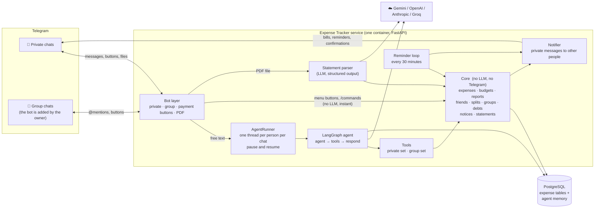
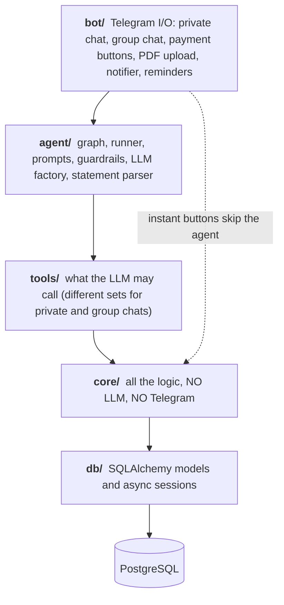
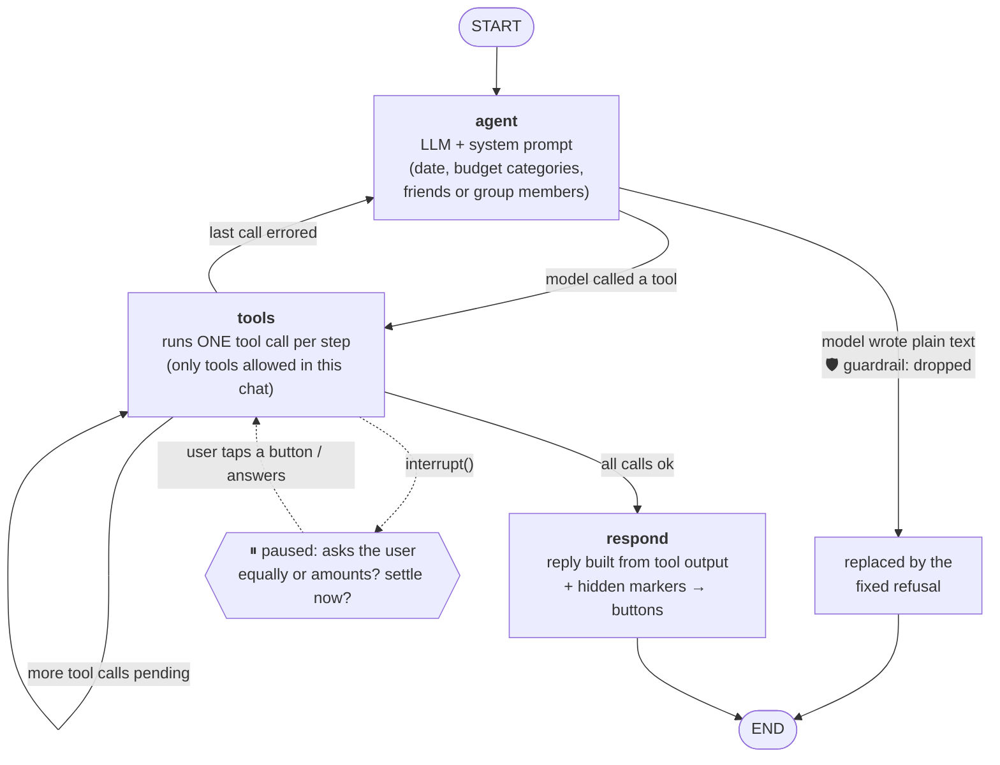
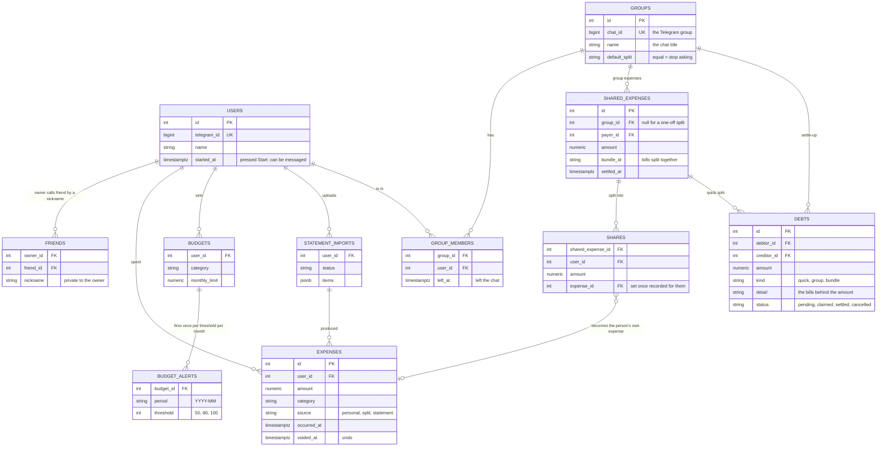
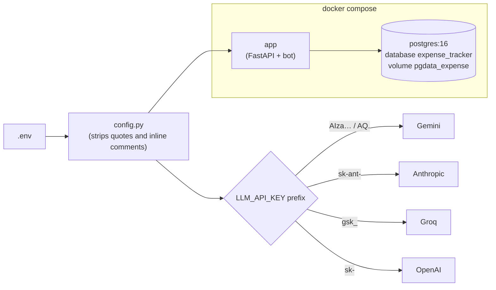

# Architecture

Expense Tracker is a Telegram bot for **personal expenses, budgets, and splitting bills with friends and groups**.
You talk to it in plain language; an LLM agent turns that into records in PostgreSQL. There are **no bank or cash accounts**:
"spent 300 on ice cream" just adds an expense.

This page shows the **structure** (what the parts are). For behaviour step by step see [FLOWS.md](FLOWS.md); for how the AI
agent loops see [STATE_GRAPH.md](STATE_GRAPH.md).

## 1. System overview

## 2. Layers and the one rule that keeps it tidy

Each layer only calls the ones **below** it. The LLM can never touch the database directly: it can only call tools, and tools
only call `core`.

| Folder | Responsibility | Key files |
|---|---|---|
| `app/bot/` | Telegram: allow-list, menu, buttons, typing indicator, group events, PDF upload, private notifications, reminder loop | `base.py`, `private.py`, `group.py`, `dues_flow.py`, `statement_flow.py`, `handlers.py` (button router), `notifier.py`, `reminders.py`, `keyboards.py` |
| `app/agent/` | The brain: LangGraph graph, per-person runner (pause/resume), system prompt, scope guardrails, LLM provider factory, statement parser | `graph.py`, `runner.py`, `prompts.py`, `guardrails.py`, `llm.py`, `statement_parser.py` |
| `app/tools/` | Thin LangChain tools: validate input, ask the human when something is missing, delegate to `core` | `expenses.py`, `budgets.py`, `reports.py`, `friends.py`, `splits.py`, `bills.py`, `groups.py`, `conversation.py` |
| `app/core/` | **All the logic.** Money maths, splitting, settling, the pay/confirm lifecycle, every message sent to other people | `expenses.py`, `budgets.py`, `reports.py` + `views.py`, `friends.py`, `splits.py`, `groups.py`, `group_flow.py`, `debts.py`, `notices.py`, `notifier.py`, `statements.py`, `periods.py`, `markers.py` |
| `app/db/` | Models and sessions (`session_scope` = commit or roll back); startup adds new columns to older databases | `models.py`, `session.py` |
| `app/api/` | `/health`, `/telegram/webhook` | `routes.py` |

There is **no internal REST API**: tools call `core` functions in the same process, so a tool call and its database changes
commit or roll back together.

## 3. Two chat contexts

The same agent serves a private chat and a Telegram group chat, with different rules:

| | Private chat | Group chat |
|---|---|---|
| Who may use it | the allow-list, friends of a listed person, and anyone in a group the owner added the bot to | **anyone in the group** |
| When the bot reacts | every message, menu button, command | **only** an @mention, a reply to the bot, or a `/command` |
| Tools the AI may call | own expenses, budgets, reports, friends, splits, `split_bills`, dues, cancel split, how to set up a group | `add_group_expense`, `split_bills`, `group_summary`, `settle_group`, `cancel_split` |
| Personal money | yes | never (it would be visible to everyone) |
| Setup | `/start` | **automatic** when an allowed person adds the bot to a group |

A tool called in the wrong chat returns an error; the graph sends it back to the AI once so it can recover.

## 4. Agent internals (LangGraph)

- **One tool call per step.** Every step is checkpointed, so a paused question never re-runs a write that already happened.
- **`respond` instead of a second LLM call.** The reply text is built from tool output: about twice as fast, and the model cannot add free text.
- **Markers.** Tools may end their output with hidden markers such as `(split #5)` or `(start #123)`. `respond` strips them and passes
  them to the bot as data, which turns them into the **Undo / Cancel split** buttons and the **"press Start"** tag for unreachable people.

## 5. Data model

Nothing is ever deleted: **undo** sets `voided_at`. LangGraph keeps its own checkpoint tables in the same database
(conversation memory and paused questions).

### How money moves

| Situation | What is stored | When it becomes someone's own expense |
|---|---|---|
| "spent 300 on ice cream" | one `expenses` row | immediately |
| Quick split with friends | a `shared_expense` + a `share` per person + a `debt` per friend | the payer's share now; a friend's share when they tap **I paid** |
| Several bills, different payers (a party) | several `shared_expenses` with one `bundle_id`, shares, and only the **netted** `debts` | people who owe nothing now; a debtor when they tap **I paid** (once, even if they owe two people) |
| Group chat expense | a `shared_expense` + shares under the group | at settle-up: people who owe nothing now; a debtor on **I paid** |
| Statement PDF | `expenses` rows (debits only) | on confirmation |

Shares are exact to the paisa, and the odd paise rotate between people so nobody drifts ahead.

## 6. Configuration and deployment

| Setting | Meaning |
|---|---|
| `TELEGRAM_MODE` | `polling` for local/dev, `webhook` for production (needs `PUBLIC_URL`) |
| `ALLOWED_TELEGRAM_IDS` | the owner side: who may use the bot and add it to groups; empty means everyone |
| `LLM_API_KEY` / `LLM_PROVIDER` / `LLM_MODEL` | the brain; provider is auto-detected from the key |
| `REMINDER_EVERY_HOURS` | how often an unpaid share is re-sent (default 48) |
| `ASK_GROUP_MIN_PEOPLE` | a one-off split this big first asks "one-off or create a group?" (default 4) |
| `BUDGET_ALERT_THRESHOLDS` | default `50,80,100` |
| `TIMEZONE` | decides what "today" and "this month" mean |

## 7. Safety and reliability

| Concern | How it is handled |
|---|---|
| LLM answers non-expense questions | Prompt rules **plus** code: the model may only act through tools, and non-expense replies are fixed text. Free text from the model is replaced by the refusal. |
| Wrong money maths | The LLM never calculates; `core` does, in one DB transaction with row locks. Shares are exact to the paisa. |
| Strangers using the bot | Allow-list for private use; the bot **leaves** a group if a non-listed person adds it. Group members can use it only inside that group and for their own bills. |
| Reading a group's private chat | It only acts on @mentions, replies and commands; with BotFather privacy mode ON Telegram does not even deliver other messages. |
| Double write after a pause | One tool call per graph step plus checkpoints. |
| Double tap on I paid / Import | Rows are locked and their status flips once. |
| Duplicate statement rows | Stable key per row; look-alikes of hand-entered expenses are flagged. |
| People the bot cannot message | They are tagged in the group with a Start button; the bill is delivered the moment they press Start. |
| Hanging or slow LLM | 25 s per request, 60 s per message, a friendly rate-limit message. |
| Prompt injection inside a PDF | The parser LLM has no tools; every date and amount is re-validated in code. |
| Secrets | `.env` is git-ignored; httpx logging is silenced (its URLs contain the bot token). |
