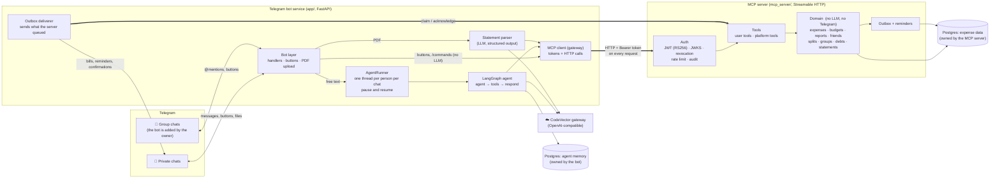
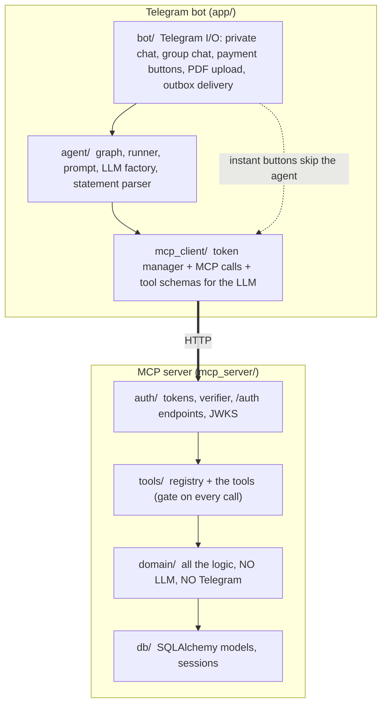
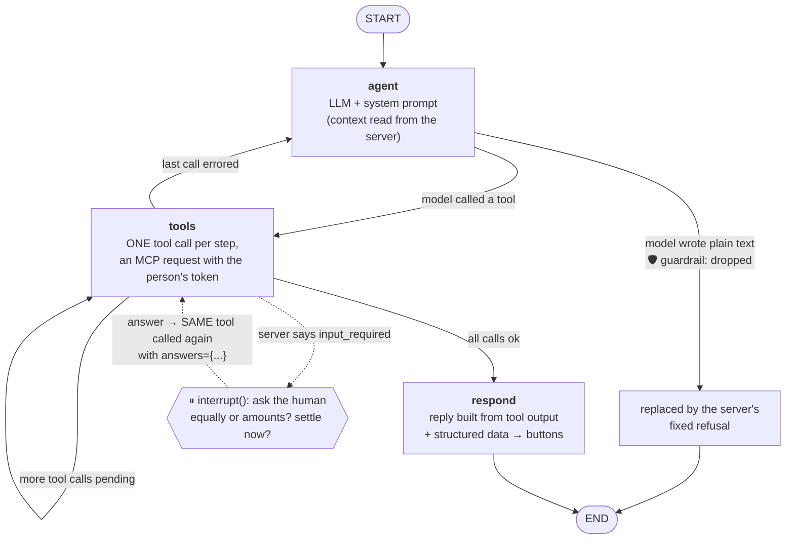
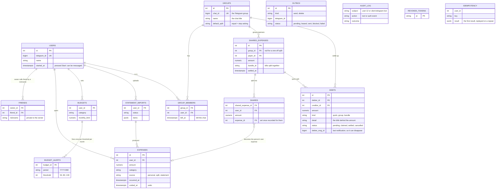
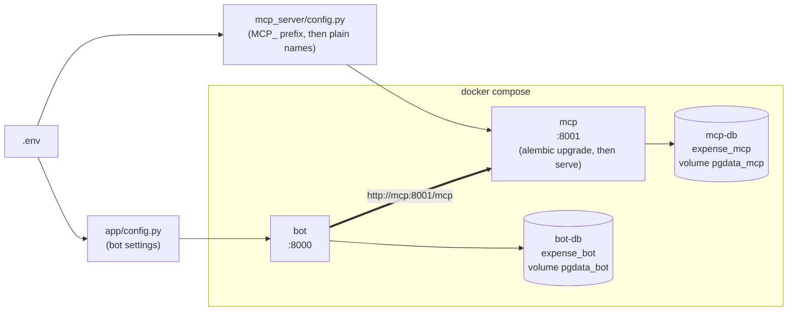

# Architecture

Expense Tracker is a Telegram bot for **personal expenses, budgets, and splitting bills with friends and groups**.
You talk to it in plain language; an LLM agent turns that into records in PostgreSQL. There are **no bank or cash accounts**:
"spent 300 on ice cream" just adds an expense.

It is built as **two services that only talk over HTTP**:

* the **MCP server** (`mcp_server/`) owns *everything about expenses*: the tools, the business logic, the database and the authentication;
* the **Telegram bot** (`app/`) owns *Telegram and the AI*: it never opens the expense database, never imports the business code, and
  reaches expense data **only by sending MCP requests** with a token the server issued.

This page shows the **structure**. For behaviour step by step see [FLOWS.md](FLOWS.md); for how the AI agent loops see
[STATE_GRAPH.md](STATE_GRAPH.md); for the protocol, tokens and tool list see [MCP.md](MCP.md).

## 1. System overview



**The rule that keeps it honest:** the only line from the bot to expense data is the thick arrow. A test
(`tests/test_architecture.py`) fails if `app/` ever imports `mcp_server`, SQLAlchemy or a database driver, and if `mcp_server/`
ever imports Telegram or LangChain.

## 2. Who does what



| Folder | Responsibility | Key files |
|---|---|---|
| `app/bot/` | Telegram: commands, buttons, typing indicator, group events, PDF upload, **delivering the messages the server queues** | `base.py`, `private.py`, `group.py`, `dues_flow.py`, `statement_flow.py`, `handlers.py`, `delivery.py`, `keyboards.py` |
| `app/agent/` | The brain: LangGraph graph, per-person runner (pause/resume), system prompt, tool sets per chat type, LLM factory, statement parser | `graph.py`, `runner.py`, `prompts.py`, `toolsets.py`, `llm.py`, `statement_parser.py` |
| `app/mcp_client/` | The only way to the data: asks the server for tokens, calls tools, turns tool definitions into what the LLM sees | `gateway.py`, `schema.py`, `types.py` |
| `mcp_server/auth/` | Issues and verifies tokens, `/auth/token`, `/auth/session`, `/auth/revoke`, JWKS | `tokens.py`, `verifier.py`, `routes.py`, `keys.py` |
| `mcp_server/tools/` | The tools. `registry.py` wraps every tool in the same gate (scope, chat context, rate limit, idempotency, audit) | `registry.py`, `expenses.py`, `budgets.py`, `reports.py`, `friends.py`, `splits.py`, `bills.py`, `groups.py`, `ui.py`, `platform.py`, `conversation.py` |
| `mcp_server/domain/` | **All the logic.** Money maths, splitting, settling, the pay/confirm lifecycle, every message for other people (queued in the outbox) | `expenses.py`, `budgets.py`, `reports.py` + `views.py`, `friends.py`, `splits.py`, `groups.py`, `group_flow.py`, `debts.py`, `notices.py`, `outbox.py`, `statements.py`, `periods.py`, `access.py`, `guardrails.py` |
| `mcp_server/db/` + `migrations/` | Models, sessions, Alembic migrations | `models.py`, `session.py`, `versions/` |
| `mcp_server/jobs.py` | Payment reminders (written to the outbox) and housekeeping | |

## 3. Two chat contexts

The same agent serves a private chat and a Telegram group chat, with different rules, **enforced by the server** (the bot also only
shows the LLM the matching tools):

| | Private chat | Group chat |
|---|---|---|
| Who may use it | the allow-list, friends of a listed person, and anyone in a group the owner added the bot to | **anyone in the group** |
| When the bot reacts | every message and command | **only** an @mention, a reply to the bot, or a `/command` |
| Tools the AI may call | own expenses, budgets, reports, friends, splits, `split_bills`, dues, `pay_friend`, cancel split, how to set up a group | `add_group_expense`, `split_bills`, `group_summary`, `settle_group`, `cancel_split` |
| Personal money | yes | never (the server refuses `add_expenses` and friends in a group session) |
| Setup | `/start` | **automatic** when an allowed person adds the bot to a group |

The chat context is a **claim inside the access token** (`chat_type`, `group_chat_id`), not a tool argument, so a caller cannot
claim to be somewhere else.

## 4. Identity and tokens

```mermaid
sequenceDiagram
    autonumber
    participant Bot as Bot (MCP client)
    participant S as MCP server
    Bot->>S: POST /auth/token  (client id + secret)
    S-->>Bot: service token  (scope platform, 10 min)
    Bot->>S: POST /auth/session  (service token; Telegram id, chat type)
    S->>S: allow-list check, group set-up, mark "started"
    S-->>Bot: session token  (scope user, 30 min, uid + chat claims)
    Bot->>S: MCP tools/call  (Authorization: Bearer session token)
    S->>S: verify signature, audience, expiry, revocation, scope, chat context
    S-->>Bot: {status, text, data, input_requests}
```

* RS256 JWT, public keys at `/.well-known/jwks.json` (key rotation by `kid`). Tokens are bound to the server (`aud`) and short-lived.
* **Every request is verified**; the protocol keeps no session on the server. A revoked or expired token is rejected at once.
* Two kinds: a **service token** (the bot proves who it is) and a **session token** (one person in one chat). The bot cannot mint
  either: the server decides, and refuses people who may not use the system.
* Group members need no separate login: the bot vouches for their Telegram identity, and the server enforces membership.

## 5. Agent internals (LangGraph)



- **One tool call per step.** Every step is checkpointed, so a paused question never re-runs a write that already happened.
- **`respond` instead of a second LLM call.** The reply text is built from tool output; the model cannot add free text.
- **Structured data, not hidden text markers.** Tools return `data` (expense ids, split ids, people to tag) next to the text; `respond`
  hands it to the bot, which turns it into the **Undo / Cancel split** buttons and the **"press Start"** tag.
- **Questions are answered by calling again.** A tool that needs an answer (how to split? settle now?) stops *before writing anything*
  and returns `input_required`. The graph pauses; the human's answer goes back on a fresh call of the same tool.

## 6. Messages for other people (the outbox)

The server never talks to Telegram. When a tool must tell someone else something ("you owe 750"), it writes an **outbox row in the same
transaction as the data**. The bot's delivery loop claims rows with a platform tool, sends them, and acknowledges each one:

```mermaid
sequenceDiagram
    participant T as Tool (server)
    participant O as Outbox table
    participant D as Bot delivery loop
    participant TG as Telegram
    T->>O: INSERT message (same transaction as the split)
    D->>O: platform_outbox_claim (leases rows for 60 s)
    D->>TG: send_message
    alt delivered
        D->>O: ack(message_id)  → stored on the debt, so it can be deleted later
    else person never pressed Start / blocked the bot
        D->>O: ack(blocked)  → remembered; the bill is sent when they press Start
    else network problem
        D->>O: ack(error)  → retried with a delay (5 attempts)
    end
```

Reminders work the same way: a background job **inside the server** queues them; the bot only delivers.

## 7. Data model (MCP server's database)



Nothing is ever deleted: **undo** sets `voided_at`. The bot's own database holds only LangGraph's checkpoint tables (conversation memory
and paused questions).

### How money moves

| Situation | What is stored | When it becomes someone's own expense |
|---|---|---|
| "spent 300 on ice cream" | one `expenses` row | immediately |
| Quick split with friends | a `shared_expense` + a `share` per person + a `debt` per friend | the payer's share now; a friend's share when they tap **I paid** |
| Several bills, different payers (a party) | several `shared_expenses` with one `bundle_id`, shares, and only the **netted** `debts` | people who owe nothing now; a debtor when they tap **I paid** (once, even if they owe two people) |
| Group chat expense | a `shared_expense` + shares under the group | at settle-up: people who owe nothing now; a debtor on **I paid** |
| Statement PDF | `expenses` rows (debits only) | on confirmation |
| Two people owe each other | the smaller total is cancelled (oldest bills first): a fully cancelled `debt` becomes `settled`, a partly cancelled one just gets a smaller amount | the debtor's share of a settled-by-netting debt, immediately |
| Paying part of a debt | the bill is cut in two `debts` rows: the paid part (`claimed`) and the remainder (`pending`) | the debtor's share, once, on the first part paid |
| Splitting a just-logged expense | the plain `expense` is voided (same amount, within an hour) and replaced by the split | the payer's own share, immediately |

Shares are exact to the paisa, and the odd paise rotate between people so nobody drifts ahead.

## 8. Configuration and deployment



Each service receives only the settings it needs (the MCP container never sees the Telegram token or the LLM key; the bot never sees the
signing key or the database URL of the expense data).

| Setting | Service | Meaning |
|---|---|---|
| `MCP_BOT_CLIENT_SECRET` | both | the secret the bot uses to get a service token |
| `TELEGRAM_BOT_TOKEN`, `TELEGRAM_MODE`, `PUBLIC_URL` | bot | Telegram; `polling` for dev, `webhook` for production |
| `CODEVECTOR_API_KEY` / `CODEVECTOR_MODEL` / `CODEVECTOR_BASE_URL` | bot | the brain: an OpenAI-compatible gateway (model and URL have defaults; compose requires the key) |
| `MCP_SERVER_URL` | bot | where the MCP server is |
| `BOT_DATABASE_URL` | bot | conversation memory only |
| `MCP_DATABASE_URL`, `MCP_ENV`, `MCP_PUBLIC_URL`, `MCP_JWT_PRIVATE_KEY` | MCP | the expense database; signing key (required in production) |
| `ALLOWED_TELEGRAM_IDS` | MCP | who may use the system and add the bot to groups; empty means everyone |
| `REMINDER_EVERY_HOURS`, `ASK_GROUP_MIN_PEOPLE`, `BUDGET_ALERT_THRESHOLDS`, `TIMEZONE`, `CURRENCY_SYMBOL` | MCP | behaviour |

## 9. Safety and reliability

| Concern | How it is handled |
|---|---|
| Anyone reaching expense data | Every MCP request needs a valid, unexpired, unrevoked, audience-bound token; scopes and chat context are checked per tool; Origin/Host are validated. |
| The bot (or an AI app) acting as someone else | Tools take **no identity argument**: the user comes from the token, and only the server mints tokens. |
| LLM answers non-expense questions | Prompt rules **plus** code: the model may only act through tools; non-expense replies are fixed text from the server; free text from the model is replaced by the refusal. |
| Wrong money maths | The LLM never calculates; the domain does, in one DB transaction with row locks. Shares are exact to the paisa. |
| Strangers using the bot | The server's allow-list refuses sessions; the bot **leaves** a group if a non-listed person adds it. |
| Reading a group's private chat | It only acts on @mentions, replies and commands; with BotFather privacy mode ON Telegram does not even deliver other messages. |
| Writing before the human answered | A tool asks **before** it writes; a question is a result, not a half-done action. |
| Double write after a pause or retry | One tool call per graph step plus checkpoints; every write carries an **idempotency key**, and a repeat returns the first result. |
| Double tap on I paid / Import | Rows are locked and their status flips once. |
| Lost or duplicated notifications | Outbox with leases, acknowledgements, retries, and "blocked until Start". |
| Abuse | Per-caller rate limit, request size limit, audit log without tokens or message text. |
| Duplicate statement rows | Stable key per row; look-alikes of hand-entered expenses are flagged. |
| Hanging or slow LLM / server | 25 s per LLM request, 30 s per MCP call, 60 s per message, friendly error messages. |
| Prompt injection inside a PDF | The parser LLM has no tools; every date and amount is re-validated in code on the server. |
| Secrets | `.env` is git-ignored; each container gets only its own secrets; httpx logging is silenced (its URLs contain the bot token). |
