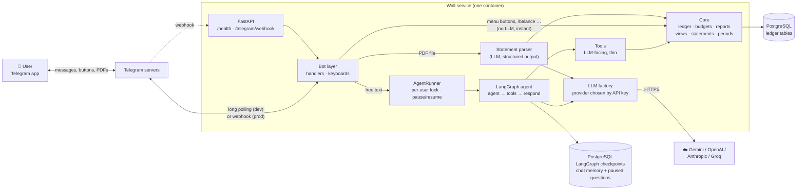
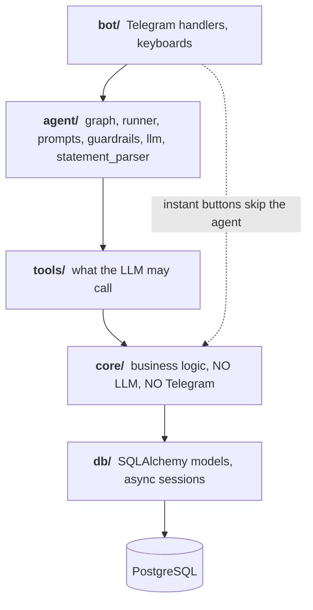
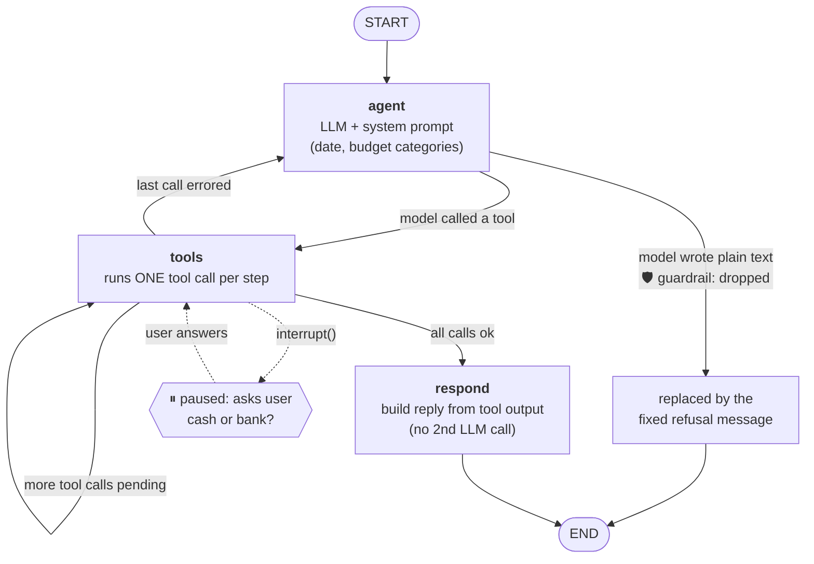
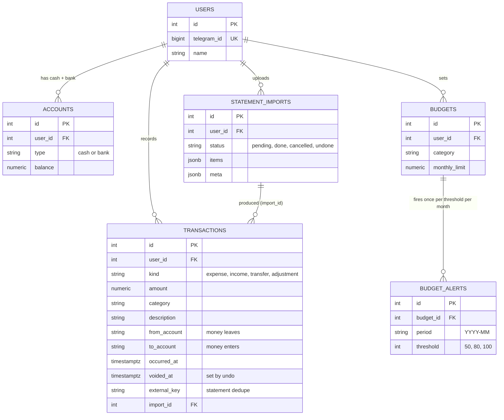
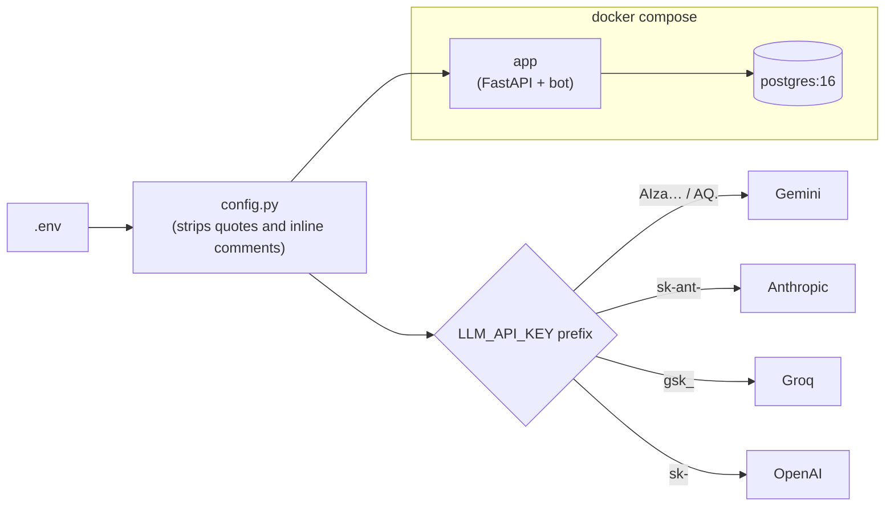

> ⚠️ **Out of date.** This page describes the earlier cash/bank wallet version. The current design (expenses, friends, bill splitting, trip groups) is described in the [README](../README.md). The agent graph (`agent → tools → respond`) is unchanged.

# Architecture

Wall is a Telegram wallet-ledger agent. You talk to it in plain language; an LLM agent turns that into
ledger entries in PostgreSQL. This page shows the **structure**: what the parts are and how they depend on
each other. For step-by-step behaviour see [FLOWS.md](FLOWS.md).

## 1. System overview

## 2. Layers and the one rule that keeps it tidy

Each layer only calls the ones **below** it. The LLM can never touch the database directly; it can only
call tools, and tools only call `core`.

| Folder | Responsibility | Key files |
|---|---|---|
| `app/bot/` | Telegram I/O: auth allow-list, menu, inline buttons, typing indicator, PDF upload | `handlers.py`, `keyboards.py`, `app.py` |
| `app/agent/` | The brain: LangGraph graph, per-user runner (pause/resume), system prompt, scope guardrails, LLM provider factory, statement parser | `graph.py`, `runner.py`, `prompts.py`, `guardrails.py`, `llm.py`, `statement_parser.py` |
| `app/tools/` | Thin LangChain tools; each validates input and delegates to `core` | `transactions.py`, `transfers.py`, `budgets.py`, `reports.py`, `conversation.py` |
| `app/core/` | All money logic. The **only** code that changes balances is `ledger.py` | `ledger.py`, `budgets.py`, `reports.py`, `views.py`, `statements.py`, `periods.py`, `formatting.py` |
| `app/db/` | Models and sessions (`session_scope` = commit or roll back) | `models.py`, `session.py` |
| `app/api/` | `/health`, `/telegram/webhook` | `routes.py` |

## 3. Agent internals (LangGraph)

Why it is built this way:

- **One tool call per step.** Every step is checkpointed, so a paused question never re-runs a write that already happened.
- **`respond` instead of a second LLM call.** The reply text is built from tool output. About twice as fast, and the model cannot add free-form text.
- **Pause = `interrupt()`.** The pending question is stored in Postgres, so it survives a restart.

## 4. Data model

The ledger idea: every transaction has a `from_account` and/or a `to_account`.

| Kind | from | to | Example |
|---|---|---|---|
| expense | cash or bank | – | "spent 300 on ice cream" |
| income | – | cash or bank | "got stipend 15k" |
| transfer | bank | cash | "withdrew 2000" |
| adjustment | one side | one side | "my bank balance is 5000" |

Nothing is ever deleted. **Undo** sets `voided_at` and reverses the balance effect.
LangGraph also keeps its own checkpoint tables in the same database (conversation memory and paused questions).

## 5. Configuration and deployment

| Setting | Meaning |
|---|---|
| `TELEGRAM_MODE` | `polling` for local/dev, `webhook` for production (needs `PUBLIC_URL`) |
| `ALLOWED_TELEGRAM_IDS` | allow-list of users; empty means everyone |
| `LLM_API_KEY` / `LLM_PROVIDER` / `LLM_MODEL` | the brain; provider is auto-detected from the key |
| `ALLOW_NEGATIVE_BALANCE` | overdraft protection (statement imports may overdraw, since they are history) |
| `BUDGET_ALERT_THRESHOLDS` | default `50,80,100` |
| `TIMEZONE` | decides what "today" and "this month" mean |

## 6. Safety and reliability design

| Concern | How it is handled |
|---|---|
| LLM answers non-wallet questions | Prompt rules **plus** code: the model may only act through tools, and non-ledger replies are fixed text from `guardrails.py`. Free text from the model is replaced by the refusal. |
| Wrong money maths | The LLM never computes balances; `ledger.py` does, inside one DB transaction with row locks. |
| Double write after a pause | One tool call per graph step plus checkpointing. |
| Double-tap on Import | Import row is locked and its status flips `pending → done`. |
| Duplicate statement rows | Stable per-row key, so re-uploads are skipped; look-alikes of hand-entered rows are flagged. |
| Hanging LLM | 25 s per request, 60 s per message hard cap, a friendly rate-limit message. |
| Prompt injection inside a PDF | The parser LLM has no tools; every date and amount is re-validated in code; text is declared "data, not instructions". |
| Secrets | `.env` is git-ignored; httpx logging is silenced (its URLs contain the bot token). |
