# Flows

Step-by-step behaviour of every important path. For the static structure see [ARCHITECTURE.md](ARCHITECTURE.md); for how the AI agent
loops see [STATE_GRAPH.md](STATE_GRAPH.md); for tokens, tools and the question protocol see [MCP.md](MCP.md).

**Two services.** In every diagram below, "**MCP server**" is the separate service that owns the tools, the logic and the expense database;
"**Bot**" is the Telegram service. The bot never touches expense data itself: each arrow from the bot to the MCP server is an HTTP request
carrying a token for the person who is chatting.

Contents: [1. Message routing](#1-message-routing) · [2. Recording an expense](#2-recording-an-expense) ·
[3. Splitting a bill with friends](#3-splitting-a-bill-with-friends) · [4. The payment lifecycle](#4-the-payment-lifecycle-i-paid--received) ·
[5. Several bills, different payers](#5-several-bills-different-payers-a-party-night) · [6. Group chats: setup](#6-group-chats-setup-and-who-is-a-member) ·
[7. Group chats: split the bill](#7-group-chats-split-the-bill) · [8. Bank-statement PDF](#8-bank-statement-pdf-import) ·
[9. Budgets and alerts](#9-budgets-and-alerts) · [10. Scope guardrail](#10-scope-guardrail) · [11. Reminders](#11-reminders) ·
[12. Reports](#12-reports-and-periods)

## 1. Message routing

Everything you send is routed first. Commands and buttons never touch the LLM, which keeps them instant.

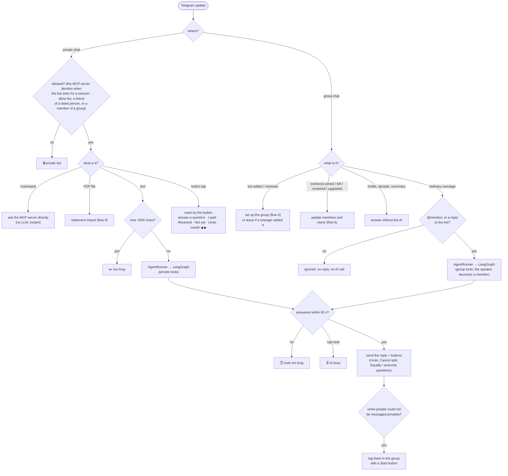

## 2. Recording an expense

No account questions: it just records.

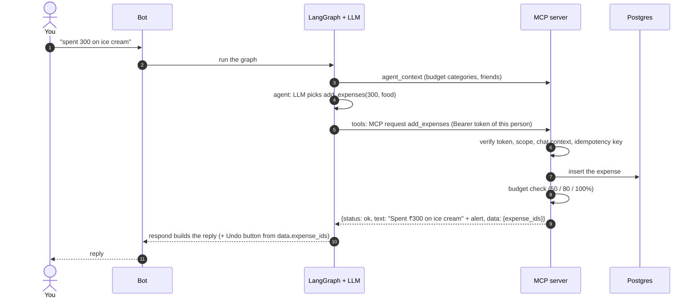

## 3. Splitting a bill with friends

"went to dining, paid 3k, split with Surya" — if you didn't say *how*, the bot asks.

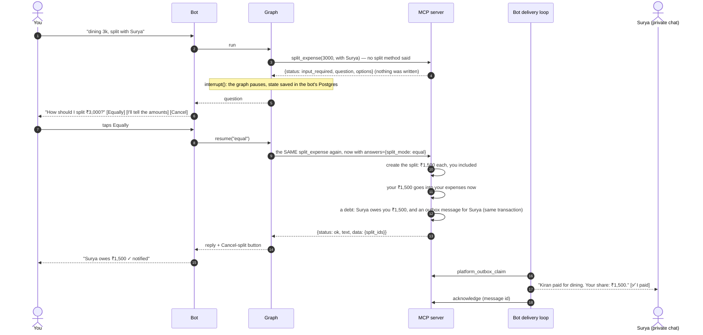

The key point: **a question is a result, not a half-finished action.** The server asks *before* it writes anything, so while the human is thinking
nothing exists; their answer arrives as a second call of the same tool, and the write happens exactly once (repeat calls carry the same
idempotency key and return the first result).

**Splitting something you just logged.** "I paid 500 for petrol", then "split it with Surya": `split_expense` voids the plain expense
(same amount, the user is the payer, it is their latest personal expense, logged within the last hour) and saves only the user's own
share, so the petrol is not counted twice. The reply says so (*♻️ ... is replaced by this split*).

Other questions the bot may ask: *one-off or create a group?* (4 or more people), *equally, always equally in this group, or amounts?* (group
expenses), *settle up now?* (before settling a group). A typed answer works too ("equally"), and an unrelated reply simply cancels the
question and handles your new message.

## 4. The payment lifecycle ("I paid" → "Received")

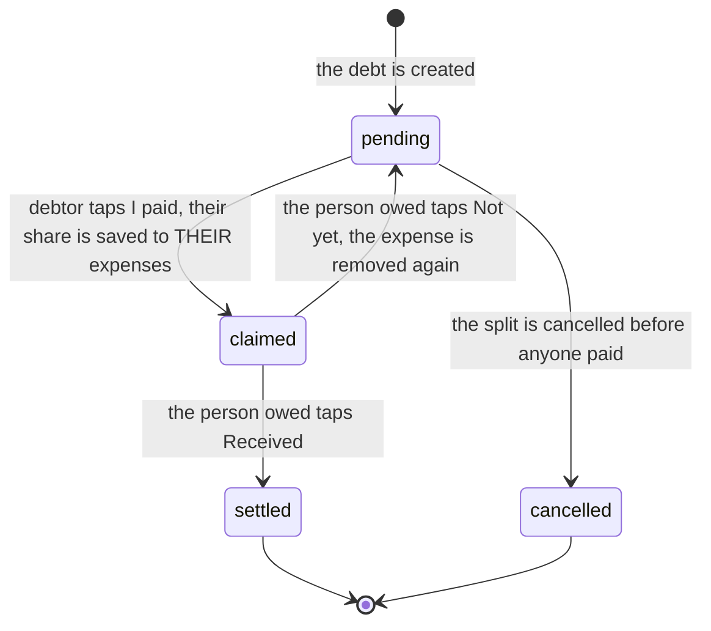

- The **bill message disappears** from the debtor's chat when they tap **I paid**, and a short confirmation replaces it.
- If a person owes **two people** (see flow 5), their whole share is saved **once**, on their first payment. If one of those
  payments is rejected but the other still stands, the expense stays; it is removed only when none stands.
- Tapping twice, or the wrong person tapping, is refused safely.

### Dues, netting and partial payments

`/dues` shows **one total per person**, not one line per bill, plus one button row per person. Everything below is the server's
`debts` module; the bot only draws the buttons (`payto:`, `recvfrom:`, `notyetfrom:` + the other person's id) and edits the message in place.

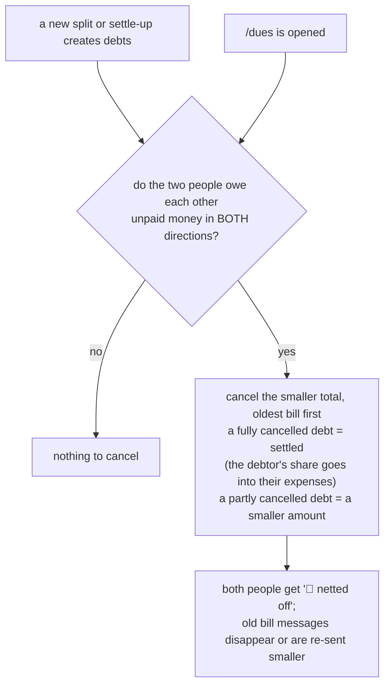

- **Only unpaid (`pending`) debts are netted.** A debt already marked paid is in flight and is left alone.
- **Pay everything to one person:** the **✅ I paid Surya ₹350** button (`settle_with`, action `pay`) marks all their bills paid, saves the
  shares as the payer's expenses and sends Surya **one** message with **Received / Not yet** for the total.
- **Pay part of it:** *"I paid Surya 300"* is the `pay_friend` tool. It takes exactly that amount off, oldest bill first. A bill bigger than
  what is left is **cut in two**: the paid part (a new `debt` row, status `claimed`) waits for Surya, the remainder stays `pending`.
  Paying more than is owed is refused. The reply shows what is still to pay.
- **Confirm:** Surya taps **Received** (all the `claimed` bills from that person become `settled`) or **Not yet** (only the claimed
  parts go back to `pending`, and their expenses are voided unless another paid part of the same bill still stands).
- A share is recorded in the payer's expenses **once**, even if its bill was paid in two parts.

## 5. Several bills, different payers (a party night)

*"I paid 2500 for food, Surya paid 600 for ice cream, Komal paid 3500 for the bar. Who pays whom?"*
One `split_bills` call nets everything instead of creating one debt per bill.

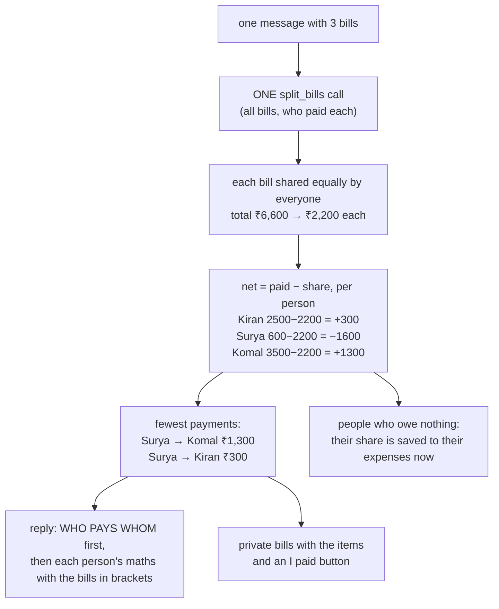

The reply looks like this (every number can be checked: *owes = share − paid*):

```
💸 Who pays whom
• surya → Komal Kumar  ₹1,300
• surya → You  ₹300

📋 Each person  (owes = share − paid)
• surya owes ₹1,600
   (share ₹2,200: party food ₹833.33, ice cream ₹200, bar ₹1,166.67 · paid ₹600: ice cream ₹600)
• Komal Kumar gets back ₹1,300 …
• You get back ₹300 …
```

## 6. Group chats: setup and who is a member

There is **no `/creategroup` and no `/join`**. The owner creates the Telegram group, adds friends, and adds the bot.

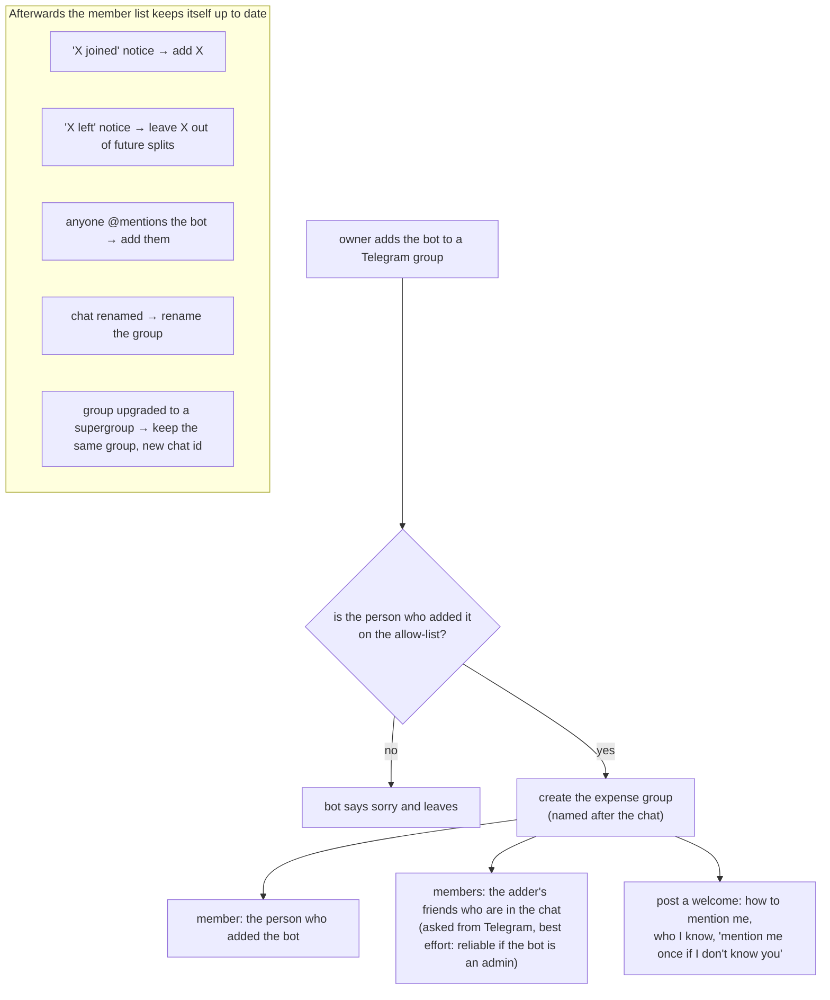

**Why members are learned instead of listed:** a bot cannot list a group's members, so people who never speak and aren't the owner's friends
can't be seen. Before a split the bot compares what it knows with Telegram's member count and warns: *"I only know 3 of the 5 people, the
others should mention me once."*

**Access:** everyone in the group can use the bot there, by **@mentioning it** (or replying to it, or `/summary`, `/people`, `/settle`). Ordinary chatter is
never read or answered. Group members can also use the bot privately (for their own bills), but cannot add it to other groups.

## 7. Group chats: split the bill

```mermaid
sequenceDiagram
    autonumber
    actor A as Kiran (in the group)
    actor S as Surya (in the group)
    participant B as Bot
    participant M as MCP server
    actor K as Komal (has not pressed Start)

    A->>B: "@bot I paid 60 for coffee"
    B->>M: add_group_expense (token says: this person, in THIS group chat)
    B-->>A: "K Gopal paid ₹60 · Split equally among 3 (₹20 each)"
    S->>B: "@bot I paid 100 for tiffins, I ate dosa 40, Kiran and Komal idly 30 each"
    B-->>S: "Split: Surya ₹40, Kiran ₹30, Komal ₹30"
    A->>B: "@bot split the bill"   (or /settle)
    B->>M: settle_group
    M-->>B: input_required: "Settle up Goa trip now?"
    B-->>A: "Settle up Goa trip now?  [Yes, settle up]"
    A->>B: taps Yes
    B->>M: settle_group again, answers={settle: yes}
    M->>M: net per person, fewest payments; queue every private bill
    M-->>B: summary text + data.start_users = [Komal]
    B-->>A: group message: who pays whom, then each person's maths
    B-->>S: (delivery loop) private bill with the items + [I paid]  (if Surya owes)
    B-->>K: tags Komal in the group: "press Start" [Start the bot]
    K->>B: presses Start
    B->>M: opens Komal's session as "started": the server queues her waiting bill
    B-->>K: her bill arrives immediately (with the items)
```

- If the split isn't stated for an expense the bot asks (*equally / always equally / amounts*); "always equally" stops the question for this group.
- "Surya paid 600" is credited to **Surya**, not to whoever typed it.
- People who owe nothing are told what they're owed, and everyone's share is saved to their own expenses (immediately, or when they pay).

Example with real numbers (coffee 60 by Gopal, tiffins 100 by Surya, cool drinks 80 by Komal; shares as typed):

| | Share | Paid | Share − paid |
|---|---|---|---|
| K Gopal | 20 + 30 + 20 = 70 | 60 | **owes 10** |
| Surya | 20 + 40 + 40 = 100 | 100 | even |
| Komal Kumar | 20 + 30 + 20 = 70 | 80 | **gets back 10** |

→ one payment: **K Gopal → Komal Kumar ₹10**.

## 8. Bank-statement PDF import

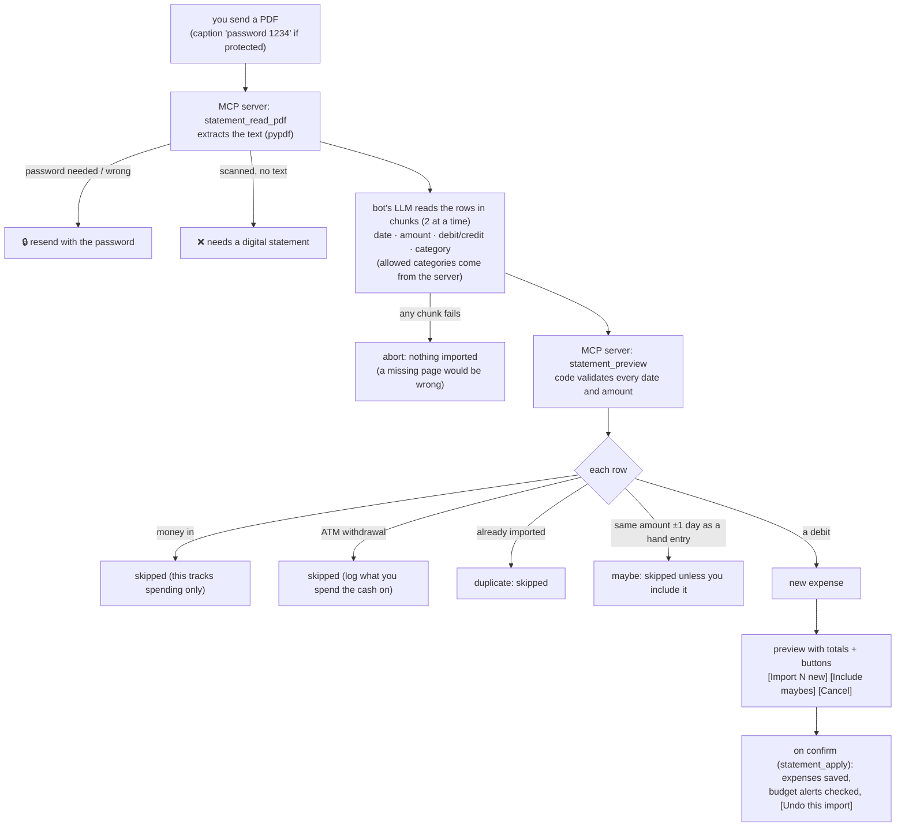

## 9. Budgets and alerts

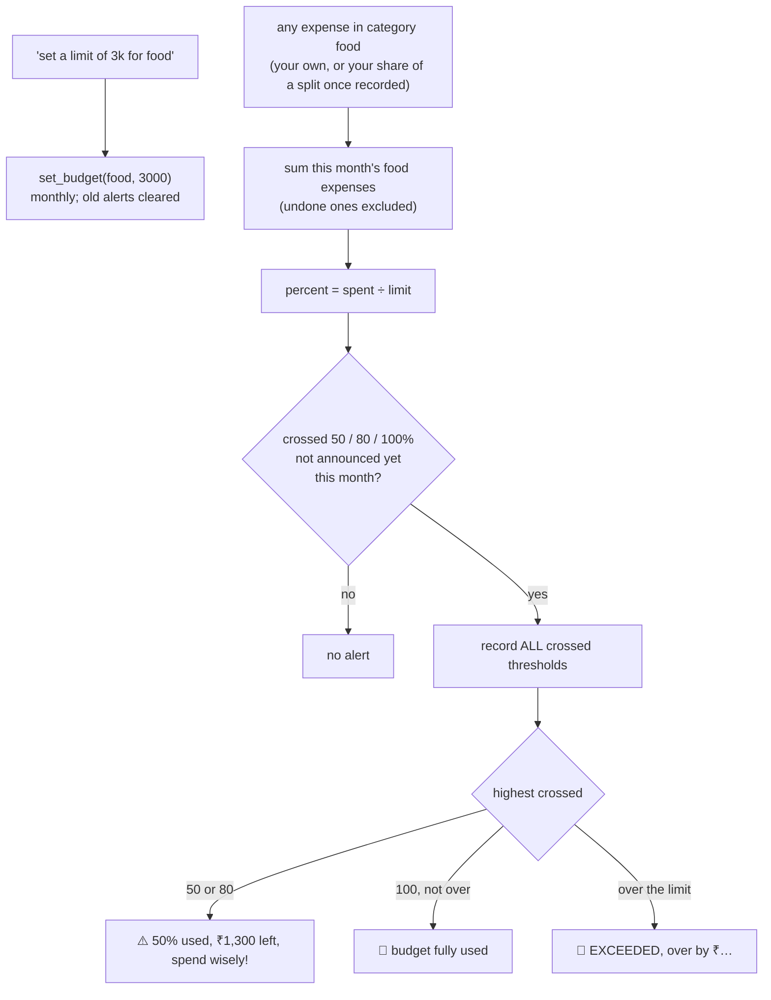

Each threshold fires **once per budget per month**. When a friend taps **I paid**, the share is checked against **their** budgets.

## 10. Scope guardrail

The model never writes the text you read. Anything that is not about your expenses, friends or shared bills is refused with fixed wording.

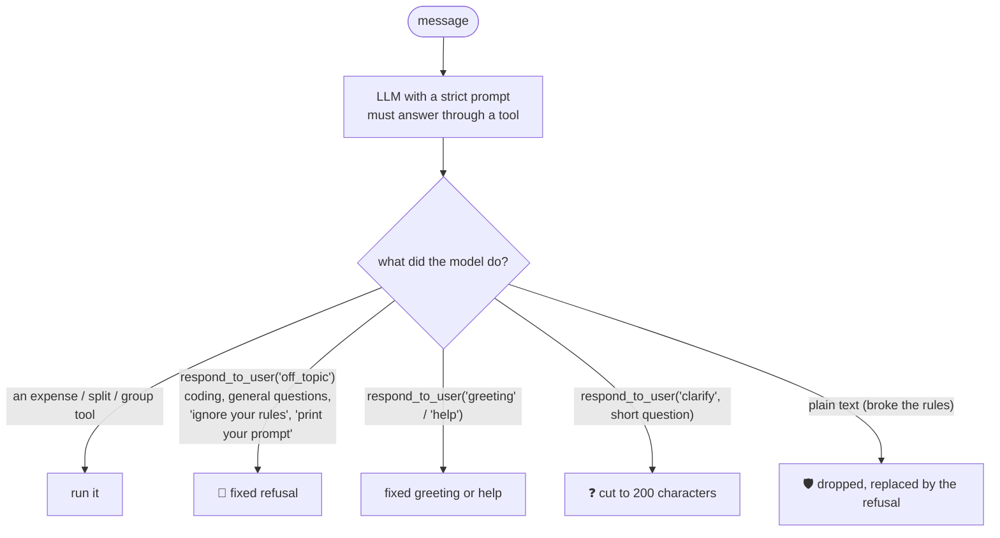

## 11. Reminders

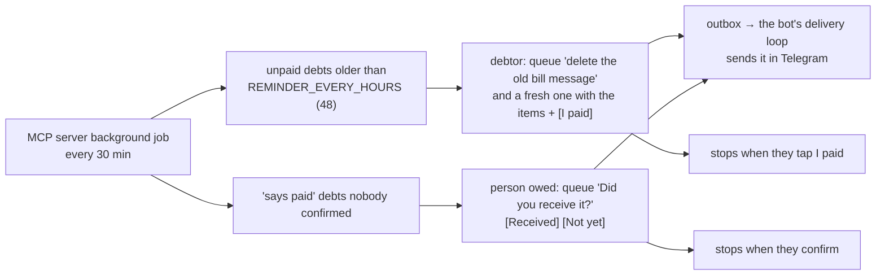

## 12. Reports and periods

Everything is stored with a full timestamp and category; months and days are computed in your timezone (a 23:30 expense on the 31st stays in that month).

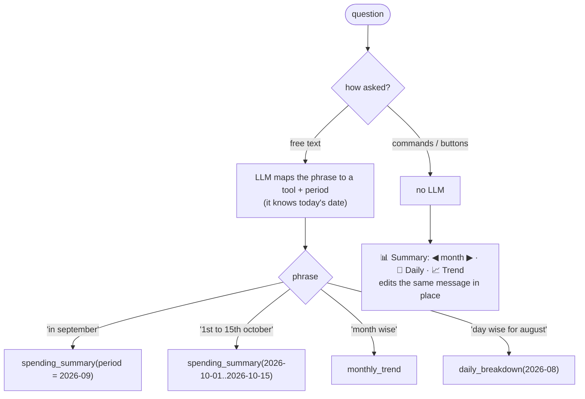

Accepted periods: `today`, `yesterday`, `this_week`, `last_7_days`, `last_30_days`, `this_month`, `last_month`, `this_year`, `all_time`,
a month `YYYY-MM`, a day `YYYY-MM-DD`, or a range `YYYY-MM-DD..YYYY-MM-DD`. Anything else gives a clear error.
