# Flows

Step-by-step behaviour of every important path. For the static structure see [ARCHITECTURE.md](ARCHITECTURE.md); for how the AI agent
loops see [STATE_GRAPH.md](STATE_GRAPH.md).

Contents: [1. Message routing](#1-message-routing) · [2. Recording an expense](#2-recording-an-expense) ·
[3. Splitting a bill with friends](#3-splitting-a-bill-with-friends) · [4. The payment lifecycle](#4-the-payment-lifecycle-i-paid--received) ·
[5. Several bills, different payers](#5-several-bills-different-payers-a-party-night) · [6. Group chats: setup](#6-group-chats-setup-and-who-is-a-member) ·
[7. Group chats: split the bill](#7-group-chats-split-the-bill) · [8. Bank-statement PDF](#8-bank-statement-pdf-import) ·
[9. Budgets and alerts](#9-budgets-and-alerts) · [10. Scope guardrail](#10-scope-guardrail) · [11. Reminders](#11-reminders) ·
[12. Reports](#12-reports-and-periods)

## 1. Message routing

Everything you send is routed first. Menu buttons and commands never touch the LLM, which keeps them instant.

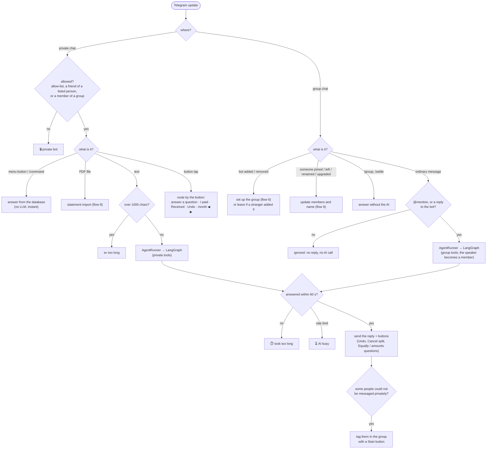

## 2. Recording an expense

No account questions: it just records.

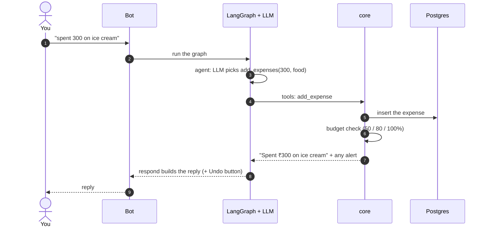

## 3. Splitting a bill with friends

"went to dining, paid 3k, split with Surya" — if you didn't say *how*, the bot asks.

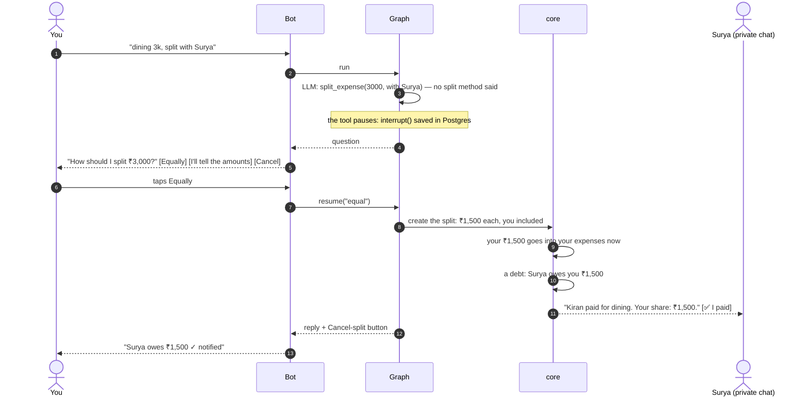

Other questions the bot may ask: *one-off or create a group?* (4 or more people), *equally, always equally in this group, or amounts?* (group
expenses), *settle up now?* (before settling a group). A typed answer works too ("equally"), and an unrelated reply simply cancels the
question and handles your new message.

## 4. The payment lifecycle ("I paid" → "Received")

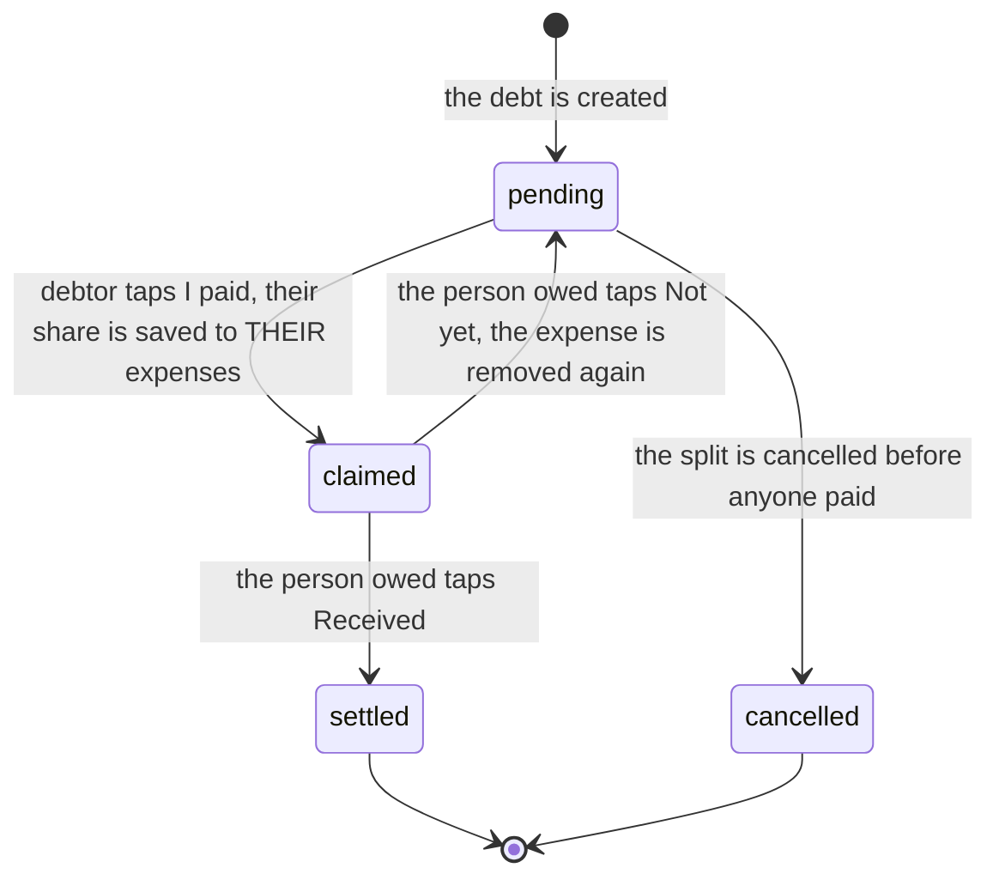

- The **bill message disappears** from the debtor's chat when they tap **I paid**, and a short confirmation replaces it.
- If a person owes **two people** (see flow 5), their whole share is saved **once**, on their first payment. If one of those
  payments is rejected but the other still stands, the expense stays; it is removed only when none stands.
- Tapping twice, or the wrong person tapping, is refused safely.

## 5. Several bills, different payers (a party night)

*"I paid 2500 for food, Surya paid 600 for ice cream, Komal paid 3500 for the bar. Who pays whom?"*
One `split_bills` call nets everything instead of creating one debt per bill.

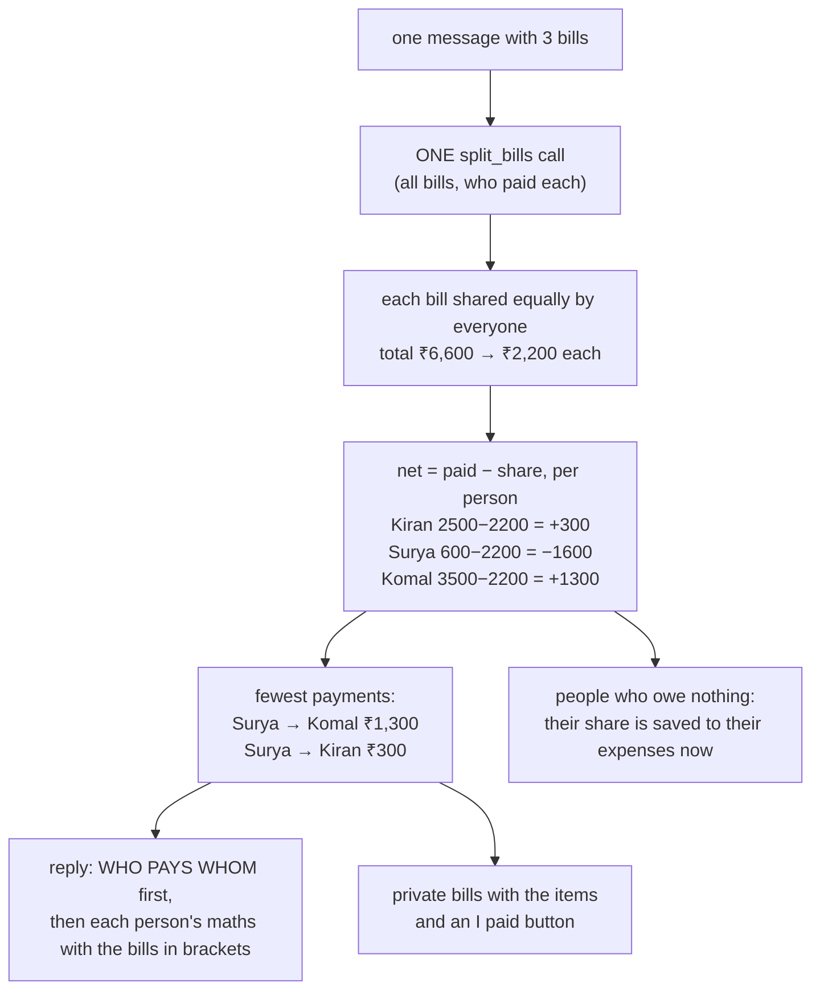

The reply looks like this (every number can be checked: *owes = share − paid*):

```
💸 Who pays whom
• surya → Komal Kumar  ₹1,300
• surya → You  ₹300

📋 Each person  (owes = share − paid)
• surya owes ₹1,600
   (share ₹2,200: party food ₹833.33, ice cream ₹200, bar ₹1,166.67 · paid ₹600: ice cream ₹600)
• Komal Kumar gets back ₹1,300 …
• You get back ₹300 …
```

## 6. Group chats: setup and who is a member

There is **no `/creategroup` and no `/join`**. The owner creates the Telegram group, adds friends, and adds the bot.

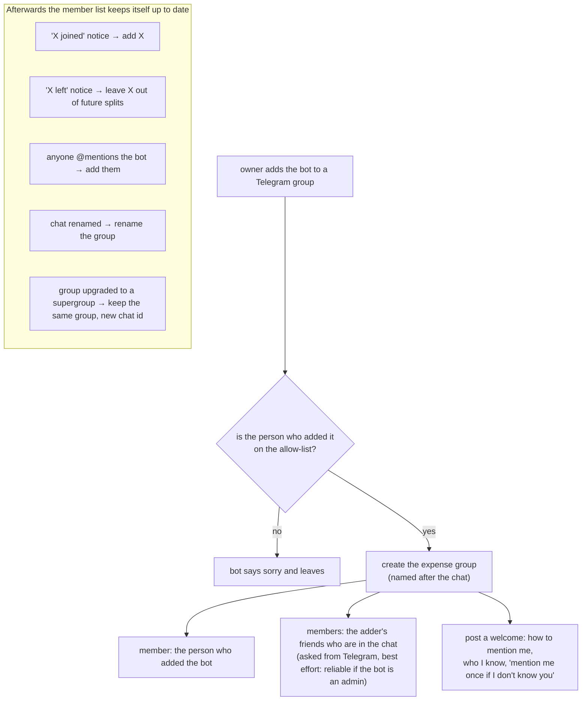

**Why members are learned instead of listed:** a bot cannot list a group's members, so people who never speak and aren't the owner's friends
can't be seen. Before a split the bot compares what it knows with Telegram's member count and warns: *"I only know 3 of the 5 people, the
others should mention me once."*

**Access:** everyone in the group can use the bot there, by **@mentioning it** (or replying to it, or `/group`, `/settle`). Ordinary chatter is
never read or answered. Group members can also use the bot privately (for their own bills), but cannot add it to other groups.

## 7. Group chats: split the bill

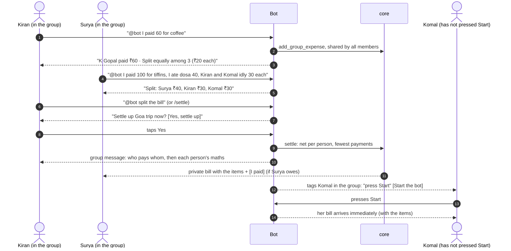

- If the split isn't stated for an expense the bot asks (*equally / always equally / amounts*); "always equally" stops the question for this group.
- "Surya paid 600" is credited to **Surya**, not to whoever typed it.
- People who owe nothing are told what they're owed, and everyone's share is saved to their own expenses (immediately, or when they pay).

Example with real numbers (coffee 60 by Gopal, tiffins 100 by Surya, cool drinks 80 by Komal; shares as typed):

| | Share | Paid | Share − paid |
|---|---|---|---|
| K Gopal | 20 + 30 + 20 = 70 | 60 | **owes 10** |
| Surya | 20 + 40 + 40 = 100 | 100 | even |
| Komal Kumar | 20 + 30 + 20 = 70 | 80 | **gets back 10** |

→ one payment: **K Gopal → Komal Kumar ₹10**.

## 8. Bank-statement PDF import

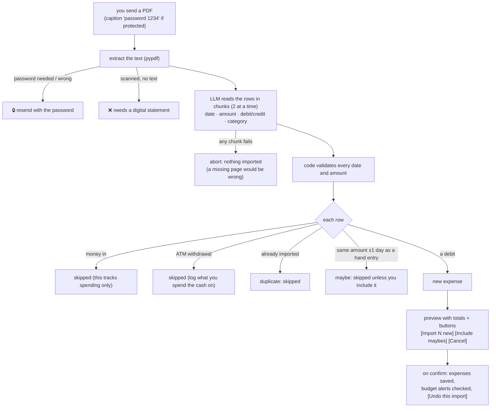

## 9. Budgets and alerts

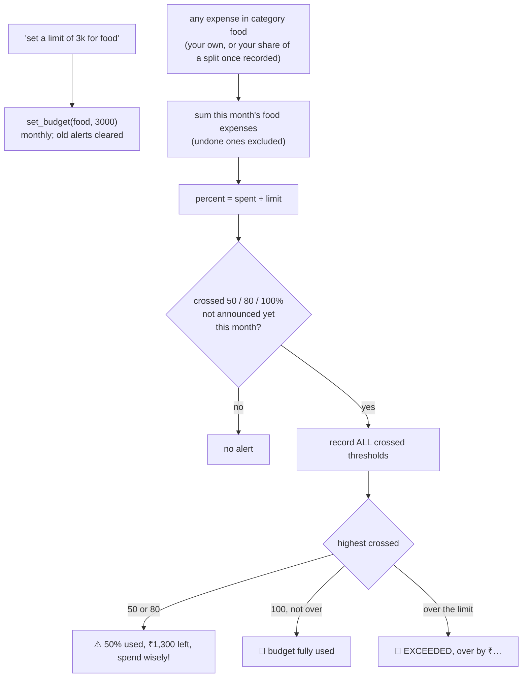

Each threshold fires **once per budget per month**. When a friend taps **I paid**, the share is checked against **their** budgets.

## 10. Scope guardrail

The model never writes the text you read. Anything that is not about your expenses, friends or shared bills is refused with fixed wording.

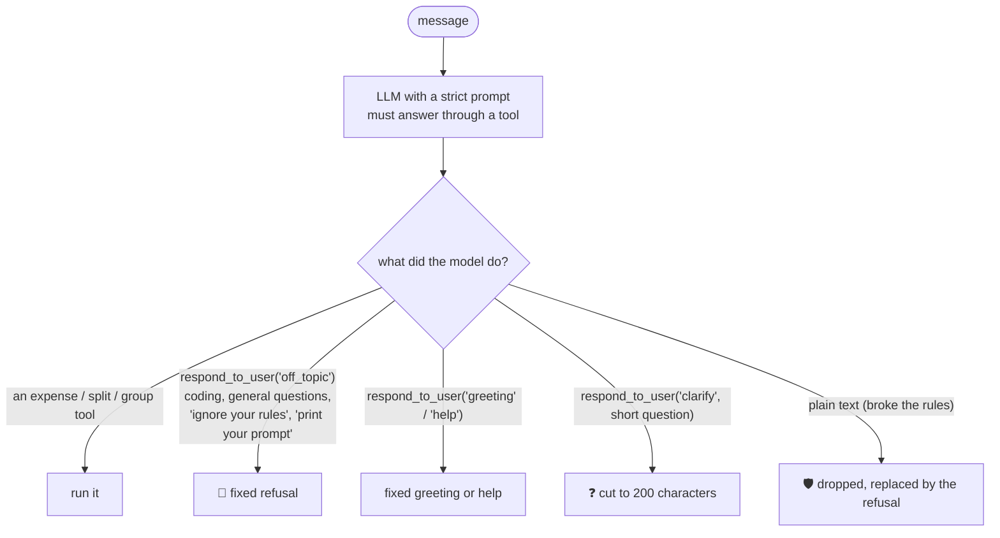

## 11. Reminders

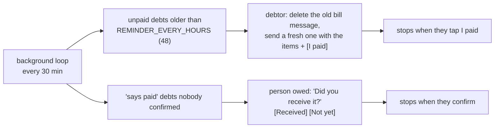

## 12. Reports and periods

Everything is stored with a full timestamp and category; months and days are computed in your timezone (a 23:30 expense on the 31st stays in that month).

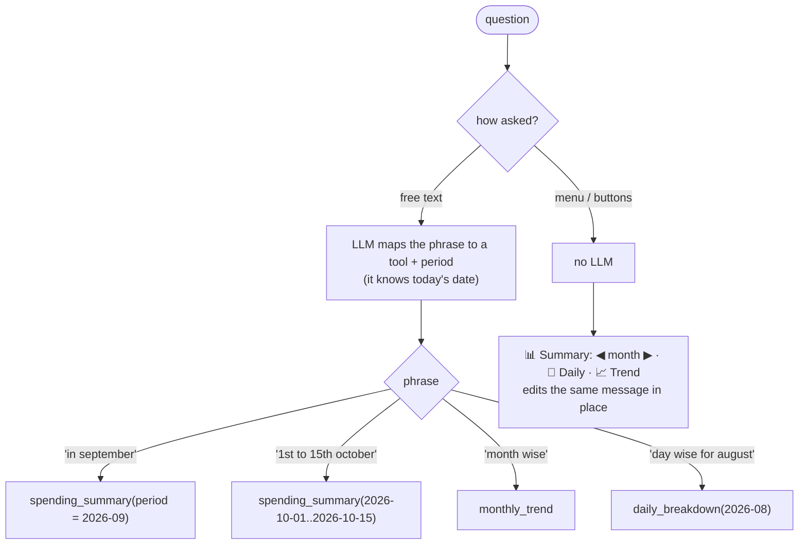

Accepted periods: `today`, `yesterday`, `this_week`, `last_7_days`, `last_30_days`, `this_month`, `last_month`, `this_year`, `all_time`,
a month `YYYY-MM`, a day `YYYY-MM-DD`, or a range `YYYY-MM-DD..YYYY-MM-DD`. Anything else gives a clear error.
