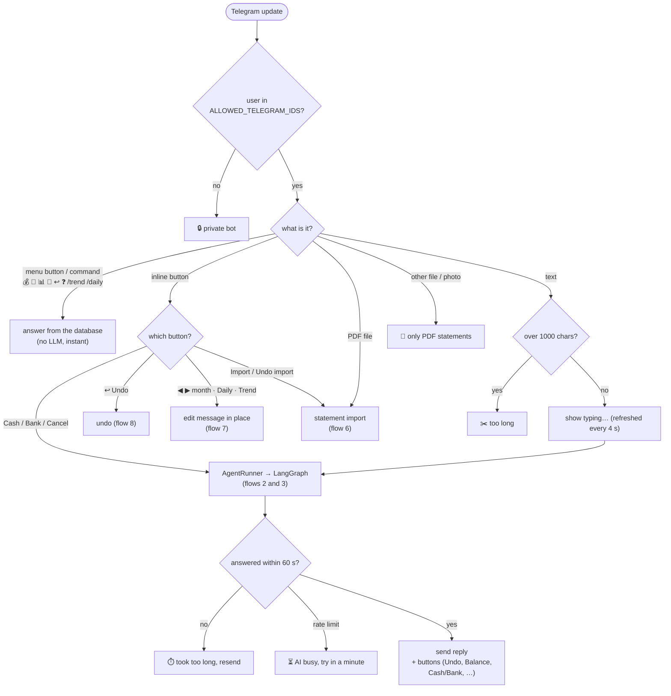
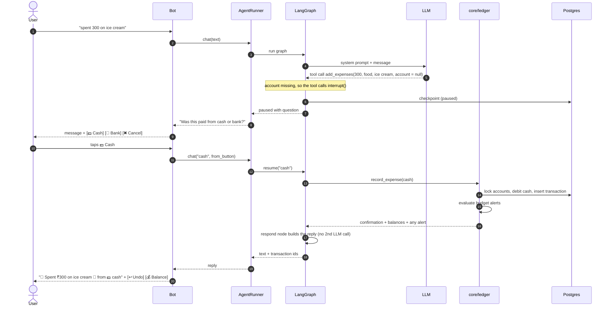
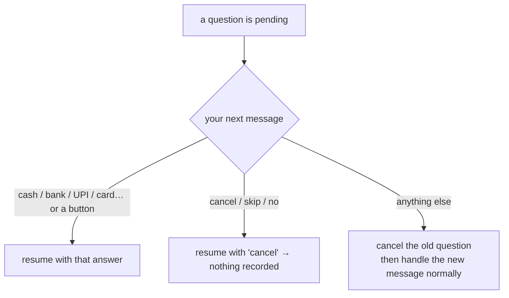
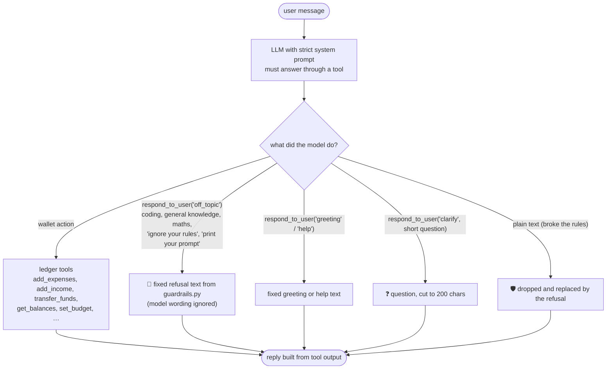
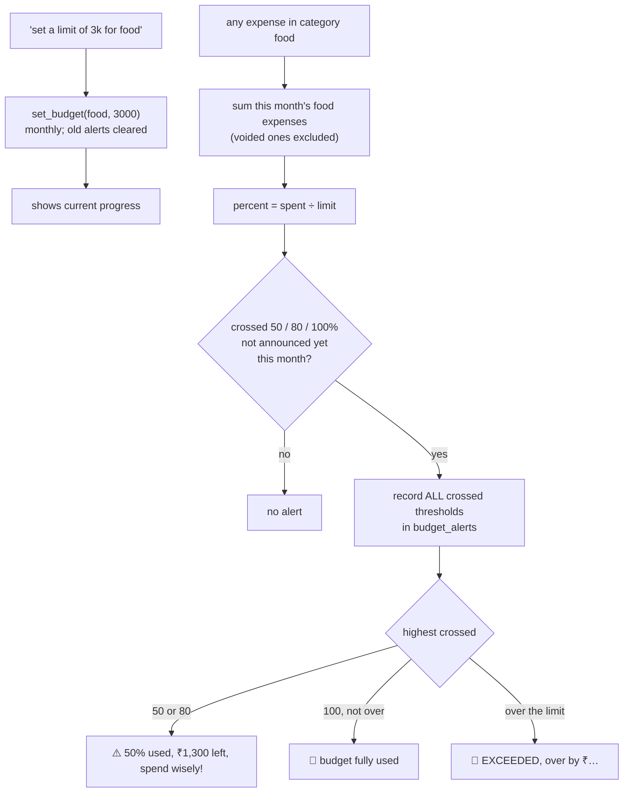
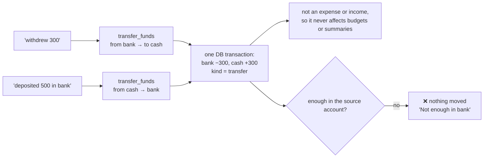
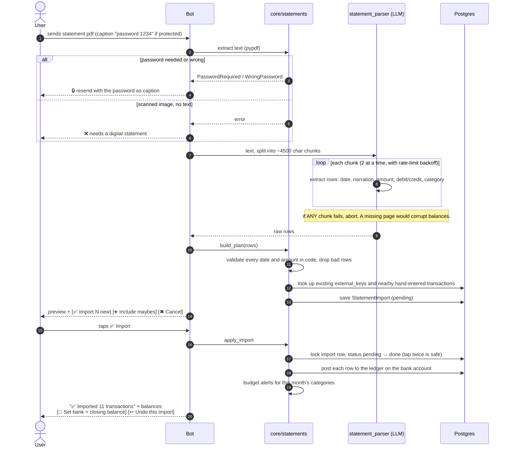
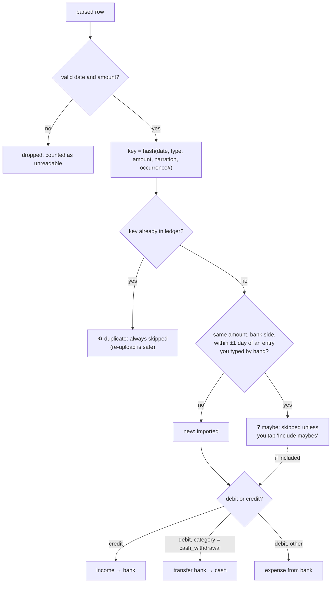
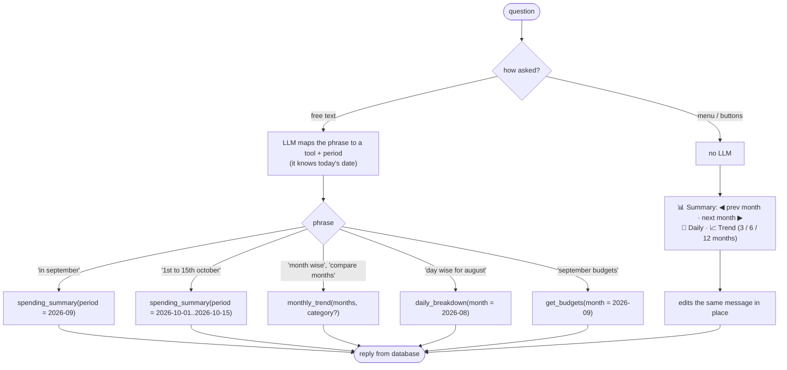
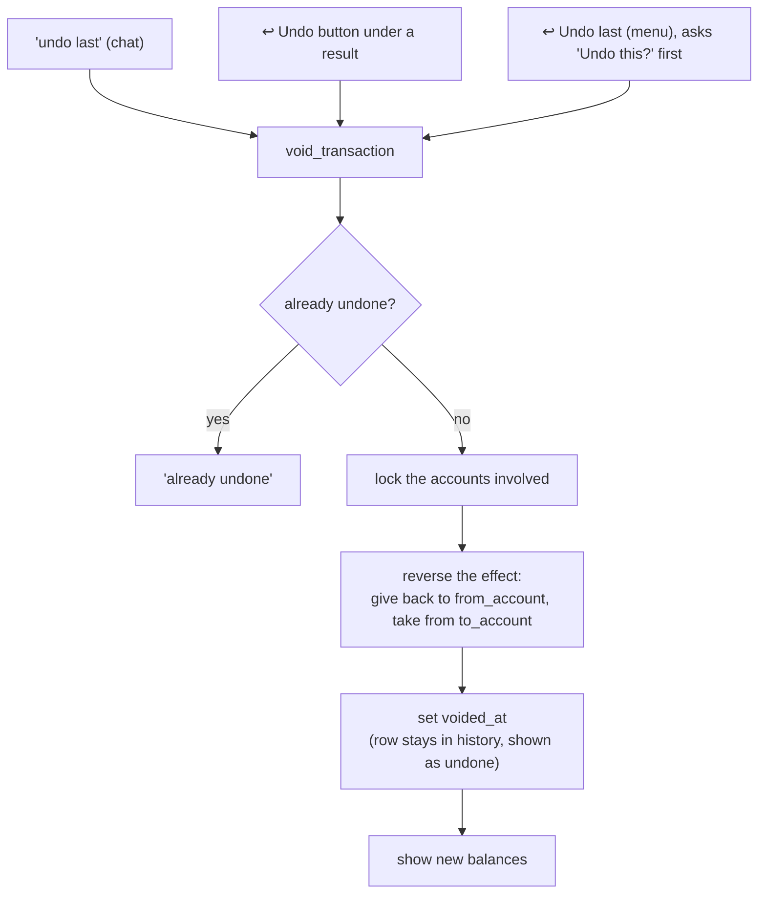

> ⚠️ **Out of date.** This page describes the earlier cash/bank wallet version. The current design (expenses, friends, bill splitting, trip groups) is described in the [README](../README.md). The agent graph (`agent → tools → respond`) is unchanged.

# Flows

Step-by-step behaviour of the important paths. For the static structure see [ARCHITECTURE.md](ARCHITECTURE.md).

Contents: [1. Message routing](#1-message-routing) · [2. Recording an expense](#2-recording-an-expense-with-the-cashbank-question) ·
[3. Scope guardrail](#3-scope-guardrail) · [4. Budgets and alerts](#4-budgets-and-alerts) ·
[5. Cash and bank transfers](#5-cash--bank-transfers) · [6. Bank-statement PDF import](#6-bank-statement-pdf-import) ·
[7. Month-wise and date-wise views](#7-month-wise-and-date-wise-views) · [8. Undo](#8-undo)

## 1. Message routing

Everything you send is routed first. Menu buttons and commands never touch the LLM, which keeps them instant.

## 2. Recording an expense (with the cash/bank question)

If you don't say cash or bank, the agent **asks** instead of guessing. This is the human-in-the-loop step.

What happens if you reply with something else while a question is pending?

If you did say the account ("spent 300 on ice cream by UPI"), the pause (steps 6–12) is skipped and it is recorded straight away.

## 3. Scope guardrail

Two layers, so safety does not depend on the model behaving. The model never writes the text you read.

## 4. Budgets and alerts

- Each threshold fires **once per budget per month**, so at 40% → 90% you get one 80% alert, not two.
- Budgets reset every calendar month in your timezone. Past months stay viewable: *"show september budgets"*.

## 5. Cash ⇄ bank transfers

## 6. Bank-statement PDF import

You send a PDF, see a preview, and only then are balances changed.

How each row is classified and applied:

Notes: statements are treated as history, so they may take the bank balance negative instead of failing.
**Undo this import** voids every transaction of that import and reverses the balances.
**Set bank = closing balance** corrects drift if you already entered some of these by hand.

## 7. Month-wise and date-wise views

Everything is stored with a full timestamp and category; months and days are computed in your timezone
(a 23:30 expense on the 31st stays in that month).

Accepted periods: `today`, `yesterday`, `this_week`, `last_7_days`, `last_30_days`, `this_month`, `last_month`, `this_year`,
`all_time`, a month `YYYY-MM`, a day `YYYY-MM-DD`, or a range `YYYY-MM-DD..YYYY-MM-DD`.
Anything else gives a clear error, never silently "all time".

## 8. Undo

