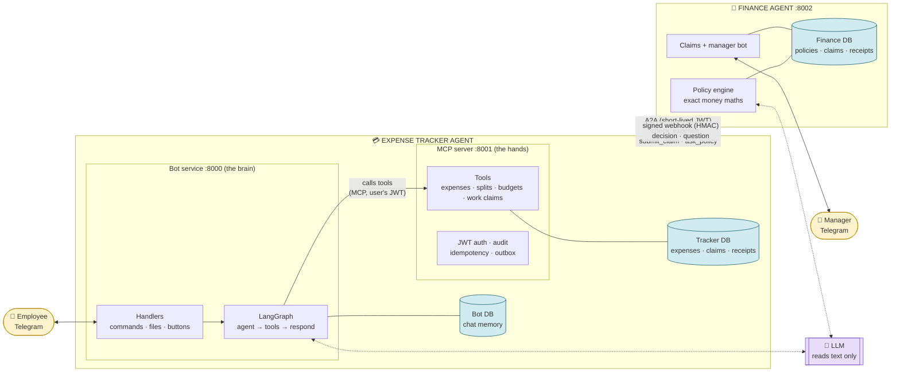
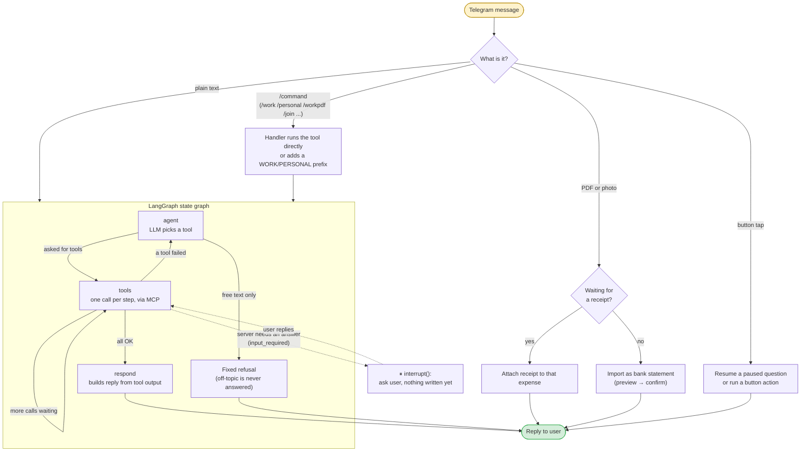
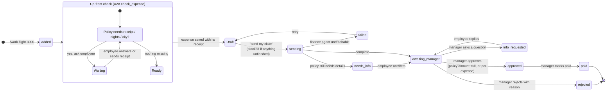

# Presentation diagrams

Three simple diagrams. They render on GitHub and in VS Code (Mermaid preview). Paste any block into https://mermaid.live to export a PNG/SVG for slides.

---

## 1. Architecture: two agents, three services, three databases

**Read it in one breath:** the **Expense Tracker Agent** is the bot (brain: chat + LangGraph) plus the MCP server (hands: tools + data). The employee chats with the bot; its AI picks a tool; the tool runs on the MCP server. Work expenses and claims go over **A2A** from the tracker agent to the **Finance Agent**, which applies the company policy and asks the **manager** in their own Telegram bot. The decision comes back by **signed webhook**.

| Rule that makes it safe | How |
|---|---|
| AI never does money maths | the policy engine uses exact `Decimal`; the LLM only reads text |
| Manager always decides | nothing is paid or saved without a button press |
| No lost messages | outbox tables in both services, retried until delivered |
| Each service owns its data | links between services are plain ids, not shared tables |

---

## 2. The state graph: how one message moves

The LangGraph has three nodes. Everything around it decides whether a message reaches it at all.

### Every case this covers

| Case | What happens |
|---|---|
| Normal expense ("coffee 120") | agent → tools (add_expense) → respond |
| Several actions in one message | tools loops, one tool per step, each checkpointed |
| Missing detail (which friend? which category?) | server returns `input_required` → graph pauses → user picks → same tool re-called, so no double write |
| Tool error | goes back to agent once to fix arguments |
| Off-topic ("write me code") | LLM free text is dropped, fixed refusal sent |
| Tool not allowed in this chat (group vs private) | error result, never executed |
| Same request sent twice | idempotency key makes the second a no-op |
| Cancel in the middle | answer "cancel" stops the tool, nothing saved |
| Bank statement PDF | handler parses, shows preview, imports only after confirm; undoable as a group |
| Receipt photo/PDF while a work expense waits | stored with that expense, not imported as a statement |

---

## 3. Work expense and claim: the full lifecycle

This is the second state machine. It runs across tracker and finance agent.

### Who does what at each step

| Step | Employee side (tracker + bot) | Finance side |
|---|---|---|
| Add expense | saves `work_expenses` row | `check_expense` reads policy, returns missing items; saves nothing |
| Send claim | `work_claims` row + receipts | stores claim, runs policy engine per item, saves `claims` + receipts |
| Needs info | asks employee in the bot | task state `input-required` |
| Manager review | waits | manager card with receipts and policy verdict per item |
| Different amount | employee told which expenses were cut | manager decides expense by expense |
| Decision | updated via signed webhook, employee notified | `webhook_events` row retried until accepted |
| Policy changes | `/policy` Q&A | manager uploads PDF/text → draft → **Save** → new version |
