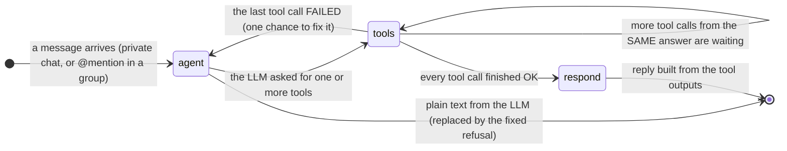
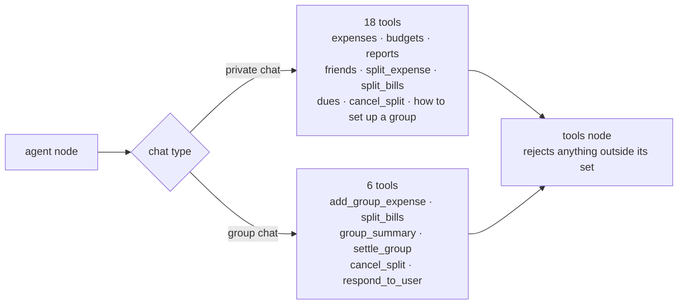
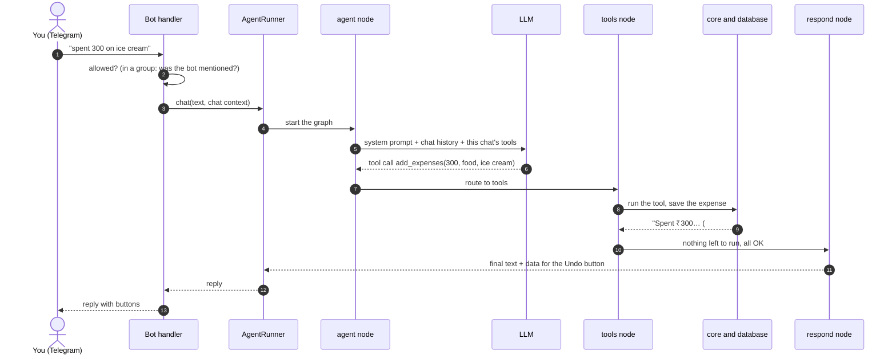
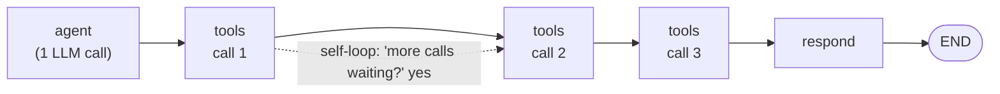
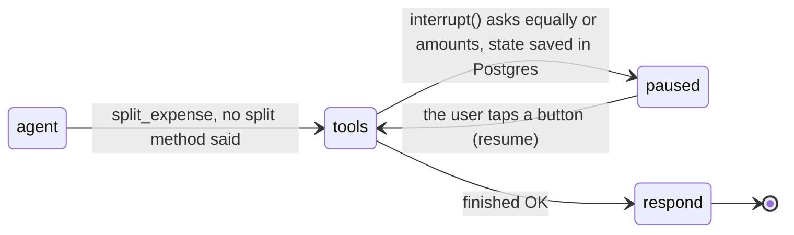

# The agent's state graph

The whole "brain" is a small LangGraph **state graph** with three nodes: **agent**, **tools** and **respond**. This page explains how a
message moves through it, and the question that matters most:

> After a tool finishes, does the flow go back to the agent, or stay in the tools?

**Short answer.** Normally it does **not** go back to the agent. It stays in `tools` until every tool the AI asked for has run, then goes to
`respond` and finishes. It returns to the agent only when a tool **fails** (for example a tool that isn't allowed in this chat).

Related: [ARCHITECTURE.md](ARCHITECTURE.md) (structure) · [FLOWS.md](FLOWS.md) (feature flows)

---

## 1. The graph



The same graph exactly as LangGraph compiled it from `app/agent/graph.py` (dotted arrows = conditional routing):


### What each node does

| Node | What it does | Calls the LLM? |
|---|---|---|
| **agent** | Builds the system prompt (today's date, the person's budget categories and friends, or the group's name and members), sends the last 40 messages to the LLM **with the tool set for this chat type**, and gets back tool calls. If the LLM writes plain text instead, that text is thrown away and replaced by the fixed refusal. | **Yes** |
| **tools** | Runs **one** pending tool call. Refuses a tool that isn't allowed in this chat (returns an error). May pause to ask the user a question. | No |
| **respond** | Joins the tool results into one message, strips hidden markers (`(split #5)`, `(start #123)`) and passes them on as data so the bot can add **Undo / Cancel split** buttons and tag people who need to press Start. | No |

### The two routing rules (the only decisions in the graph)

| After… | If… | Go to |
|---|---|---|
| **agent** | the LLM asked for tools | `tools` |
| **agent** | the LLM wrote plain text instead | `END` (fixed refusal) |
| **tools** | some tool calls from the same LLM answer have **not run yet** | `tools` again |
| **tools** | everything has run and the last batch had an **error** | `agent` |
| **tools** | everything has run and all were OK | `respond` |
| **respond** | always | `END` |

### Two tool sets, chosen by chat type



Personal money never appears in a group chat: the model isn't even shown those tools, and the tools node refuses them if they are called anyway.

---

## 2. From a message to the reply



---

## 3. How many LLM calls? Real traces

Recorded by running the real graph with scripted LLM answers and the current tools:

### A. One tool

```
 1. agent    LLM asked for ['get_expenses']
 2. tools    get_expenses: success
 3. respond  reply built from tool output
 LLM calls: 1
```

### B. Two tools in one message: "spent 300 on ice cream and set a food limit of 3k"

```
 1. agent    LLM asked for ['add_expenses', 'set_budget']
 2. tools    add_expenses: success
 3. tools    set_budget: success
 4. respond  reply built from tool output
 LLM calls: 1
```

The LLM returns **all** tool calls together; the graph loops **inside `tools`** (one per step) and only then goes to `respond`.
Three or four tools cost the same single LLM call.



Why one tool per step? Every step is saved (checkpointed). If one tool has to pause and ask a question, only that tool waits, and tools that
already finished are never run twice, so nothing is written twice.

### C. A question to the user (human in the loop): "dining 3k split with surya"

```
 1. agent    LLM asked for ['split_expense']
 2. tools    PAUSED: asks the user a question (state saved)
 3. --       user taps 'equal'
 4. tools    split_expense: success
 5. respond  reply built from tool output
 LLM calls: 1
```

The pause happens **inside** `tools`. Tapping a button resumes the same tool; the agent isn't called again. The paused state lives in Postgres,
so it survives a restart.



### D. A tool that isn't allowed in this chat: the only time it goes back to the agent

```
 1. agent    LLM asked for ['add_expenses']              (in a group chat)
 2. tools    add_expenses: error (not available in a group chat)
 3. agent    LLM asked for ['respond_to_user']           <- the LLM sees the error and tries again
 4. tools    respond_to_user: success
 5. respond  reply built from tool output
 LLM calls: 2
```

### E. The model answers in plain text (breaking the rules)

```
 1. agent    plain text -> replaced by the refusal
 LLM calls: 1
```

---

## 4. Every possible path

| # | What happens | Path through the graph | LLM calls |
|---|---|---|---|
| 1 | Normal request ("spent 300 on lunch") | START → agent → tools → respond → END | 1 |
| 2 | Several actions in one message | agent → tools → tools → … → respond → END | 1 |
| 3 | A question is needed (how to split, one-off or group, settle now?) | agent → tools (pauses) … you tap … tools resumes → respond → END | 1 |
| 4 | A tool fails or isn't allowed here | agent → tools (error) → agent → tools → respond → END | 2 |
| 5 | Greeting, off-topic, "need more info" | agent → tools (`respond_to_user`, fixed wording) → respond → END | 1 |
| 6 | The AI breaks the rules with plain text | agent → END (the fixed refusal is sent) | 1 |
| 7 | You cancel or change topic while a question waits | tools resumes with "cancel" → respond → END, then your new message starts at START | 0 + a new run |
| 8 | Menu buttons, commands, **I paid / Received** taps, group `/group` and `/settle` | never enter the graph: answered straight from `core` | 0 |
| 9 | Group chat message that doesn't mention the bot | ignored before the graph | 0 |

A tool that keeps failing is stopped by a 40-step safety limit, and the user gets a friendly error.

---

## 5. What the "state" is

The graph state is one list: `messages`. Each node adds to it (it never edits earlier entries). For "spent 300 on ice cream and set a food limit of 3k":

| # | Added by | Message in the list |
|---|---|---|
| 1 | you | Human: "spent 300 on ice cream and set a food limit of 3k" |
| 2 | **agent** | AI: tool_calls = [add_expenses, set_budget] |
| 3 | **tools** (step 1) | Tool result for add_expenses |
| 4 | **tools** (step 2) | Tool result for set_budget |
| 5 | **respond** | AI: the final reply (what you see) |

After each tool, `pending_tool_calls()` looks at the last AI message and asks **"which of its tool calls don't have a result yet?"**
Some are missing → `tools` again. None missing → check for errors → `agent` or `respond`.

The state is saved to Postgres after every step under a thread id of **person + chat** (`tg-<id>` in private, `tg-g<chat>-<id>` in a group),
so each person has their own conversation memory and their own paused questions, even in the same group.

---

## 6. Limits you should know about

| Limit | What it means |
|---|---|
| **No tool chains that depend on each other** | The LLM sees tool results only when something fails, so it can't do "look at the result, **then** decide the next tool" within one message. It decides all tool calls up front. |
| **Retry loop is not tightly capped** | After an error the graph returns to `agent`. The prompt asks for one retry, but the real stop is LangGraph's `recursion_limit = 40`. |
| **Free text is never forwarded** | By design (the guardrail). Even a clarifying question goes through the `respond_to_user` tool. |

---

## 7. Where this lives in the code

| Piece | File |
|---|---|
| Graph, routing rules, `respond` node, per-chat tool sets | `app/agent/graph.py` |
| Tool lists (private / group) | `app/tools/__init__.py` |
| Pause and resume (`ask_choice` / `interrupt`) | `app/tools/_common.py`, `app/agent/runner.py` |
| Hidden markers → buttons | `app/core/markers.py` |
| Guardrail wording | `app/agent/guardrails.py`, `app/tools/conversation.py` |
