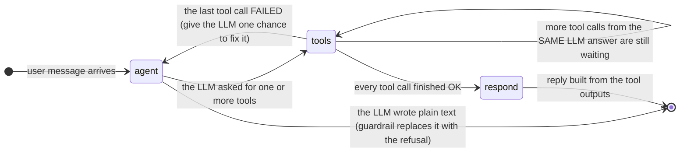
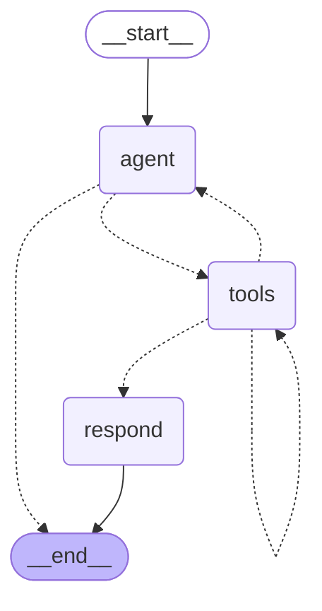
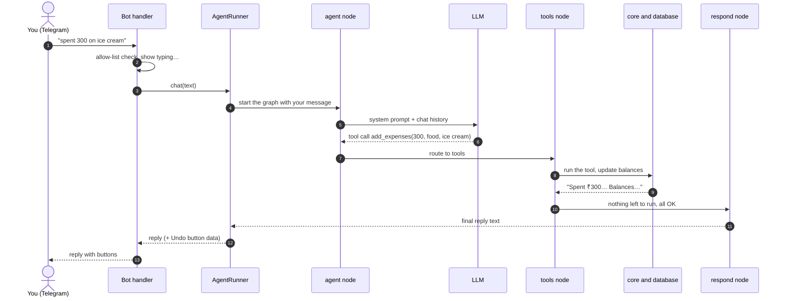
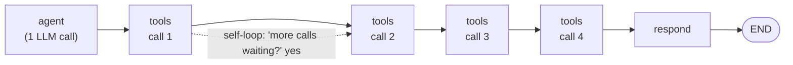
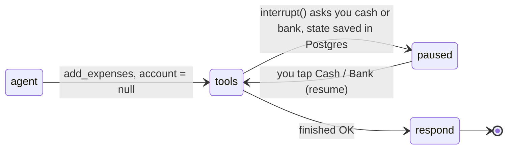

> ⚠️ **Out of date.** This page describes the earlier cash/bank wallet version. The current design (expenses, friends, bill splitting, trip groups) is described in the [README](../README.md). The agent graph (`agent → tools → respond`) is unchanged.

# The agent's state graph

The whole "brain" is a small LangGraph **state graph** with just three nodes: **agent**, **tools** and **respond**.
This page explains exactly how a message moves through it, and answers the question that matters most:

> After a tool finishes, does the flow go back to the agent, or stay in the tools?

**Short answer.** Normally it does **not** go back to the agent. It stays in `tools` until every tool the agent asked for has run,
then goes to `respond` and finishes. It only returns to the agent when a tool **fails**.
Details and real traces are below.

Related: [ARCHITECTURE.md](ARCHITECTURE.md) (structure) · [FLOWS.md](FLOWS.md) (feature flows)

---

## 1. The graph



The same graph exactly as LangGraph compiled it from `app/agent/graph.py` (dotted arrows = conditional routing):



### What each node does

| Node | What it does | Calls the LLM? |
|---|---|---|
| **agent** | Sends the system prompt (today's date, your budget categories) and recent chat to the LLM. The LLM answers with **tool calls**. | **Yes** |
| **tools** | Runs **one** pending tool call (add expense, transfer, get balance…). Each tool talks to `core/` and the database. | No |
| **respond** | Joins the tool outputs into one reply (and keeps the latest balance line). | No |

### The two routing rules (the only decisions in the graph)

These are the two small functions in `graph.py`. Everything else is fixed.

| After… | If… | Go to |
|---|---|---|
| **agent** | the LLM asked for tools | `tools` |
| **agent** | the LLM wrote plain text instead | `END` (reply replaced by the fixed refusal) |
| **tools** | some tool calls from the same LLM answer have **not run yet** | `tools` again |
| **tools** | everything has run and the last batch had an **error** | `agent` |
| **tools** | everything has run and all were OK | `respond` |
| **respond** | always | `END` |

---

## 2. From typing in Telegram to the reply



In words:

1. **You type** in Telegram. The bot checks you are allowed, shows "typing…" and hands the text to the `AgentRunner`.
2. The runner starts the graph. The **agent** node asks the LLM *what to do*. The LLM does **not** answer you; it answers with a **tool call**
   such as `add_expenses(amount=300, category="food")`.
3. The graph moves to **tools**, which runs that tool. The tool writes to the database and returns text like
   "Spent ₹300… Balances…".
4. Nothing else is waiting, so the graph moves to **respond**, which turns the tool output into the message you see. **Done.**
   The LLM was called **once**.

---

## 3. What happens with 1, 3 or 4 tools?

These are real traces recorded from the actual graph with scripted LLM answers (the same code paths the tests run).

### A. One tool: "what's my balance"

```
 1. agent    LLM asked for 1 tool call: [get_balances]
 2. tools    ran get_balances (success)
 3. respond  built the reply from tool outputs
 LLM calls: 1
```

### B. Three tools in one message: "got 15k stipend in bank, spent 200 on tea in cash, withdrew 500"

```
 1. agent    LLM asked for 3 tool calls: [add_income, add_expenses, transfer_funds]
 2. tools    ran add_income (success)
 3. tools    ran add_expenses (success)
 4. tools    ran transfer_funds (success)
 5. respond  built the reply from tool outputs
 LLM calls: 1
```

This answers your main question. The LLM returns **all three** tool calls **together in one answer**. The graph then loops
**inside `tools`** (steps 2 → 3 → 4), running one tool per step, and only then goes to `respond`.
It does **not** go back to the agent between tools, so 3 tools still cost **1** LLM call. Four tools behave the same way: `tools` runs four times.



Why one tool per step instead of all at once? Every step is saved (checkpointed). If one tool has to pause and ask you "cash or bank?",
only that tool waits, and tools that already finished are never run twice, so nothing is written twice.

### C. A tool fails: the only time it returns to the agent

```
 1. agent    LLM asked for 1 tool call: [add_expenses]
 2. tools    ran add_expenses (error)        <- e.g. invalid amount
 3. agent    LLM asked for 1 tool call: [get_balances]   <- LLM sees the error and tries again
 4. tools    ran get_balances (success)
 5. respond  built the reply from tool outputs
 LLM calls: 2
```

When the last batch had an **error**, the graph goes back to **agent** and the LLM sees the error message and can correct its arguments.
The error itself is never shown to you. `respond` only uses the successful results.

### D. The model answers in plain text (breaking the rules)

```
 1. agent    plain text -> guardrail
 LLM calls: 1
```

The text is thrown away and replaced by the fixed refusal, and the graph ends immediately. No tools run.

### E. Pausing to ask you "cash or bank?"



The pause happens **inside** the `tools` step. Your answer resumes the same tool; it does not start a new run through the agent.
The paused state is in Postgres, so it survives a restart.

---

## 4. What the "state" actually is

The graph state is just one list: `messages`. Each node adds to it. For case B (three tools) it grows like this:

| # | Added by | Message in the list |
|---|---|---|
| 1 | you | Human: "got 15k stipend…, spent 200 on tea…, withdrew 500" |
| 2 | **agent** | AI: tool_calls = [add_income, add_expenses, transfer_funds] |
| 3 | **tools** (step 1) | Tool result for add_income |
| 4 | **tools** (step 2) | Tool result for add_expenses |
| 5 | **tools** (step 3) | Tool result for transfer_funds |
| 6 | **respond** | AI: the final reply (what you see) |

How the loop decides: after each tool, `pending_tool_calls()` looks at the last AI message and asks
**"which of its tool calls don't have a result yet?"** Some are missing → `tools` again. None missing → check for errors → `agent` or `respond`.

---

## 5. Limits you should know about

| Limit | What it means |
|---|---|
| **No tool chains that depend on each other** | The LLM sees tool results only when something **fails**. So it cannot do "call `get_balances`, look at the answer, **then** decide to call `transfer_funds`" inside one message. It decides all tool calls up front. That fits this app (each message is a self-contained ledger action), but "if my cash is below 500, withdraw 1000" won't work as one command. |
| **Retry loop is not tightly capped** | After an error the graph returns to `agent`. The prompt asks the LLM to retry once, but the real stop is LangGraph's `recursion_limit = 40` steps. If a tool keeps failing, the user sees the generic "brain hiccuped" message. |
| **Free text is never forwarded** | By design (the guardrail). Even a clarifying question goes through the `respond_to_user` tool. |

If you want dependent tool chains, the change is small. Route `tools → agent` after **read-only** tools (balance, history) so the LLM can look at
the result and decide the next step, while write tools still go straight to `respond`. That costs one extra LLM call only for those chained cases.

---

## 6. Where this lives in the code

| Piece | File |
|---|---|
| Graph, routing rules, `respond` node | `app/agent/graph.py` (`build_graph`, `after_agent`, `after_tools`, `pending_tool_calls`) |
| Pause and resume (`interrupt`) | `app/tools/_common.py` (`ask_account`) and `app/agent/runner.py` |
| Guardrail | `app/agent/guardrails.py`, `app/tools/conversation.py` |
| Tests proving the behaviour | `tests/test_agent_flow.py` (`test_two_tool_calls_in_one_turn_run_sequentially`, `test_tool_error_goes_back_to_llm_for_a_retry`), `tests/test_guardrails.py` |
