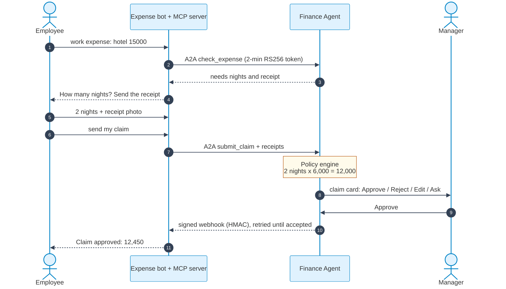

# Letting Two AI Agents Talk Money: Work Reimbursements Over A2A, MCP and Telegram

*Fission Labs · Engineering · by the Python intern team*

```mermaid
%%{init: {"theme":"base","themeVariables":{"fontFamily":"Segoe UI, Helvetica, Arial","fontSize":"16px","primaryColor":"#f1f5f9","primaryBorderColor":"#475569","lineColor":"#334155"}}}%%
flowchart LR
    subgraph TG["Telegram"]
        direction TB
        PC["Private chats"]
        GC["Group chats"]
        MB["Manager bot"]
    end
    subgraph BOT["Telegram bot (app/)"]
        direction TB
        BL["Bot layer<br/>handlers, buttons, PDF upload"]
        RU["Runner<br/>pause and resume"]
        AG["LangGraph agent<br/>agent, tools, respond"]
        MC["MCP client<br/>short-lived token + HTTP"]
        BL --> RU --> AG --> MC
    end
    subgraph MCP["MCP server (mcp_server/)"]
        direction TB
        AU["Auth<br/>RS256 JWT, rate limit, audit"]
        TL["Tools<br/>scope + context gate"]
        DM["Domain, no LLM<br/>expenses, budgets, splits, debts"]
        OB["Outbox, reminders,<br/>A2A client"]
        AU --> TL --> DM --> OB
    end
    subgraph FIN["Finance Agent (finance_agent/)"]
        direction TB
        A2["A2A server<br/>agent card, skills"]
        PO["Policy parser + QA"]
        EN["Policy engine<br/>exact decimals"]
        A2 --> PO --> EN
    end
    LLM["CodeVector LLM gateway"]
    D1[("Postgres<br/>agent memory")]
    D2[("Postgres<br/>expense data")]
    D3[("Postgres<br/>policy + claims")]
    PC & GC <--> BL
    MB <--> A2
    MC ==>|"HTTP + Bearer"| AU
    OB ==>|"A2A + signed token"| A2
    A2 -.->|"HMAC webhook"| OB
    AG --> LLM
    PO --> LLM
    AG --> D1
    DM --> D2
    EN --> D3
    classDef bot fill:#f1f5f9,stroke:#475569,color:#0f172a
    classDef mcp fill:#ecfdf5,stroke:#0f766e,color:#0f172a
    classDef fin fill:#fef3c7,stroke:#b45309,color:#0f172a
    class BL,RU,AG,MC bot
    class AU,TL,DM,OB mcp
    class A2,PO,EN fin
```



Picture an employee who types "cab 450 to the client" into a chat window on a Tuesday night. A week later a manager is looking at a card that says the hotel claim is "partly eligible, ₹12,000 of ₹15,000", with the rule that caused the cut and the version of the policy it came from. Between those two moments, two separate AI agents, two databases, two Telegram bots and a handful of signed tokens have exchanged messages, and not one rupee was calculated by a language model.

That last detail is the whole point of the system we built, so it is worth spending the rest of this post on why. This is a walk through an expense tracker that began as a simple Telegram bot and grew into a small multi-agent platform: an MCP server that owns the data, a bot that owns the conversation, and a Finance Agent that owns the company's policy and talks to the bot over A2A.

## Why a chat bot, and why it had to stay boring

The starting point was modest. People say what they spent, in whatever words they like, and the bot records it. "Spent 300 on ice cream" becomes a ₹300 food expense. Budgets warn at 50, 80 and 100 percent. Friends can split a dinner, and a single "dues" view shows one total per person rather than one line per pizza.

Chat is a forgiving interface for humans and an unforgiving one for money. A language model will happily read "paid Surya back" as a ₹3,000 settlement when the real debt is ₹350. So the first design decision was to make the model a translator and nothing more. It turns sentences into tool calls. Everything after the tool call is ordinary, deterministic code with exact decimals, database transactions and an audit trail.

## Splitting the system along the line that matters

The first version was one service. It worked, and it was also the kind of thing where the Telegram handler, the LangChain agent and the SQL all lived in one import graph. When we wanted to let other AI applications use the same expense data, that stopped being acceptable.

So we cut it in two. The **MCP server** exposes the expense domain as tools over Streamable HTTP: add expenses, set budgets, split a bill, settle a debt. It has no idea Telegram exists and has no LLM inside it. The **bot** owns the conversation: a LangGraph agent that loops through agent, tools and respond, a runner that pauses and resumes per person per chat, and the Telegram plumbing.

The only line from the bot to the data is an HTTP call carrying a bearer token. We did not leave that as a convention. A test fails the build if the bot package ever imports the server package, SQLAlchemy or a database driver, and if the server ever imports Telegram or LangChain. Architectural rules that live only in a README erode within a quarter; rules that fail CI do not.

Every request is checked in the same order: token signature, issuer, audience, expiry, revocation, tool scope, chat context, rate limit. Tokens are short-lived RS256 JWTs, and the chat context, whether you are in a private chat or a group, is a claim inside the token rather than an argument the model supplies. A caller cannot claim to be somewhere else, and a group session is refused personal-money tools by the server regardless of what the model asks for.

## Writes that survive a retry

Agents retry. Networks hiccup. A resumed graph step can run twice. If "split this dinner" creates two bills, the system is wrong in a way users notice immediately.

Two mechanisms handle it. Every write tool accepts an idempotency key, and repeating a successful write with the same key returns the first result without writing anything. And the agent is limited to one tool call per graph step, so a resumed step never repeats a finished write and two pending questions cannot collide. The pause itself, say the bot asking whether a split should be equal, is stored in Postgres, so a restart does not forget the conversation.

## The reimbursement problem

Personal expenses are a closed loop: one person, one ledger. Work expenses are not. They involve a policy the company wrote, a manager who has to approve, and a back-and-forth that can last days. We deliberately did not bolt this onto the tracker. A company's policy and approval logic belongs to the company, so it became its own service: the **Finance Agent**, with its own database and its own Telegram bot for the manager.

The two services speak **A2A**, the Agent2Agent protocol. The Finance Agent publishes an agent card at a well-known URL listing its skills, and the tracker reads that card before it calls. The skills are few and plain: join a company with a code, ask a policy question, ask the manager something, submit a claim, reply to a request for details, check a claim's status. Each call returns an A2A task, and the task state carries real meaning. A policy question that needs more information comes back as input-required; the follow-up continues the same task rather than starting a new one.

Trust runs both ways, and it is asymmetric on purpose. Calls from tracker to Finance carry a two-minute RS256 token that names the employee, so it is the tracker, not the employee, vouching for who is asking. The Finance Agent checks the signature against the tracker's published keys, the issuer, the audience and the scope. In the other direction, the manager's decisions return as a signed webhook with an HMAC over the body. Approval can take days, which is far too long to hold a task open, so the Finance Agent stores each event until the tracker accepts it, retries with back-off, and the tracker ignores duplicates.

## Reading a policy without trusting the reader



A manager pastes a policy, or sends a PDF. The agent reads it and replies with how it understood it: hotels up to ₹6,000 a night with a receipt above ₹500, meals up to ₹1,000 a day, gym not reimbursed. Nothing is saved until the manager taps Save, and every save is a new version, with each claim recording the version it was checked against.

Each rule has a limit and a unit, and the unit decides how it is applied. A per-day cap multiplies by days. A per-claim cap is one pool shared by every item of that kind, so a ₹3,000 cab and a ₹3,500 train on a ₹5,000 limit pay ₹5,000, not ₹6,500. A per-month cap spans claims. Rules marked not-covered win over rules that pay, which is how beer at dinner ends up as alcohol rather than dinner. Tiered limits, say Tier-1 cities at ₹4,000 and others at ₹2,000, pick a variant from the city, or ask which applies.

A compiled rule, simplified, looks something like this:

```json
{
  "category": "hotel",
  "limit": 6000,
  "unit": "per_night",
  "receipt_over": 500,
  "covered": true
}
```

The model's job ends at producing that structure and at answering questions like "how many nights was this?" The function that applies it lives in `finance_agent/policy/engine.py` and uses decimals. The model never touches an amount. We would defend that choice against almost any other design, because it is the one that makes the system auditable: when a manager asks why ₹12,000 and not ₹15,000, the answer is a rule, a unit and a multiplication, not a paragraph of reasoning.

## Asking for the right thing at the right time

The most useful behavior was also the simplest. When an employee adds a work expense, the Finance Agent evaluates it immediately, through a `check_expense` skill, and the bot asks for exactly what the policy wants for that expense. A flight above the receipt threshold prompts for a photo or PDF. A typed "I have it" is not accepted; the file is. Answers like "2 nights" or "yes, it was approved" attach to the right expense without anyone quoting numbers, and "send my claim" is refused with a specific reason while something is still missing.

By the time the manager sees the claim it is complete, with receipts traveling alongside it and the policy's recommendation on each line. The manager chooses: approve, reject, a different amount that walks through the items one at a time, or a question back to the employee. The agent recommends and the human decides, and that line does not move.

Even the manager chatting casually is bounded. A message that is not a command gets a short answer about the company's policy, claims or employees, or a one-line refusal. It cannot change the policy; only the explicit set-policy and edit-policy flows followed by Save do that.

## Where it is still rough

We would rather list these than have you find them. Receipts are a present-or-absent check today; there is no photo reading yet. One person belongs to one company. "Paid" is marked by the manager, not confirmed by a payment system. Reminders run inside the MCP server, so it must run as a single instance or people get two nudges. And outside AI applications still need a credential issued by the operator, since sign-in with Telegram is the next step rather than a finished one.

None of these threaten the architecture. They are the places where the boundaries we drew make the next feature easy to add, which is the only honest test of a boundary.

## The takeaway

Splitting a system into agents is not interesting by itself. The interesting part is deciding what each side is allowed to be wrong about. Here the language model may misread a sentence, and the worst outcome is a confirmation button the user declines. It may not compute an amount, change a policy or approve a claim. The protocols, MCP for tools and A2A between agents, are what make that division enforceable rather than aspirational.

## References

- Model Context Protocol: modelcontextprotocol.io
- Agent2Agent (A2A) protocol: a2a-protocol.org
- Project documentation in this repository: `docs/ARCHITECTURE.md`, `docs/MCP.md`, `docs/REIMBURSEMENT.md`

---

**Book a Free Consultation.** If you are designing agents that touch money, policy or approvals, talk to the team at Fission Labs.
