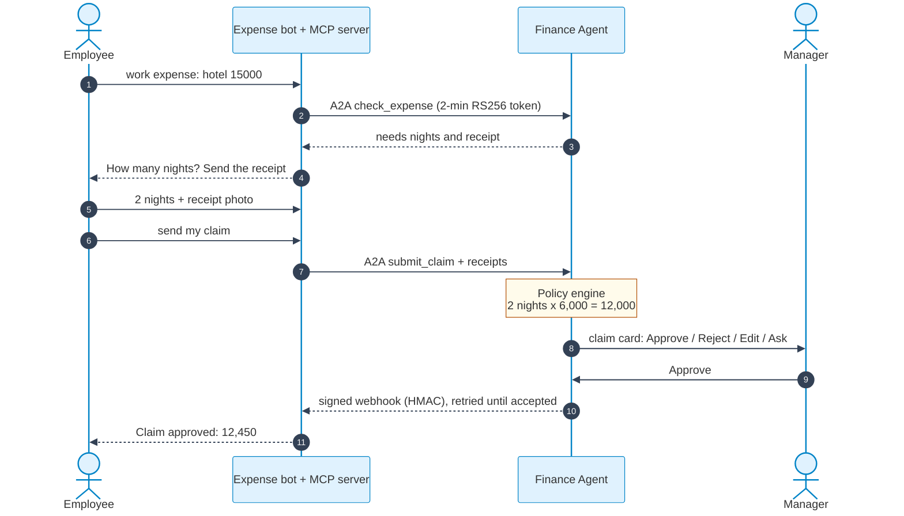

# We Built a Telegram Expense Bot. Then Two AI Agents Started Negotiating Reimbursements.

### The language model never touches a single rupee. That's the whole trick.

**TL;DR:** Five Python interns at Fission Labs built a Telegram bot where you type "spent 300 on ice cream" and it just works. Then we added work reimbursements, where an employee's bot talks to a company's Finance Agent over A2A, and a manager approves in a separate bot. The LLM reads sentences. Plain code does the math. Here's what we learned.

---

```mermaid
%%{init: {"theme":"base","themeVariables":{"fontFamily":"Segoe UI, Helvetica, Arial","fontSize":"16px","primaryColor":"#f1f5f9","primaryBorderColor":"#475569","lineColor":"#334155"}}}%%
flowchart LR
    subgraph TG["Telegram"]
        direction TB
        PC["Private chats"]
        GC["Group chats"]
        MB["Manager bot"]
    end
    subgraph BOT["Telegram bot (app/)"]
        direction TB
        BL["Bot layer<br/>handlers, buttons, PDF upload"]
        RU["Runner<br/>pause and resume"]
        AG["LangGraph agent<br/>agent, tools, respond"]
        MC["MCP client<br/>short-lived token + HTTP"]
        BL --> RU --> AG --> MC
    end
    subgraph MCP["MCP server (mcp_server/)"]
        direction TB
        AU["Auth<br/>RS256 JWT, rate limit, audit"]
        TL["Tools<br/>scope + context gate"]
        DM["Domain, no LLM<br/>expenses, budgets, splits, debts"]
        OB["Outbox, reminders,<br/>A2A client"]
        AU --> TL --> DM --> OB
    end
    subgraph FIN["Finance Agent (finance_agent/)"]
        direction TB
        A2["A2A server<br/>agent card, skills"]
        PO["Policy parser + QA"]
        EN["Policy engine<br/>exact decimals"]
        A2 --> PO --> EN
    end
    LLM["CodeVector LLM gateway"]
    D1[("Postgres<br/>agent memory")]
    D2[("Postgres<br/>expense data")]
    D3[("Postgres<br/>policy + claims")]
    PC & GC <--> BL
    MB <--> A2
    MC ==>|"HTTP + Bearer"| AU
    OB ==>|"A2A + signed token"| A2
    A2 -.->|"HMAC webhook"| OB
    AG --> LLM
    PO --> LLM
    AG --> D1
    DM --> D2
    EN --> D3
    classDef bot fill:#f1f5f9,stroke:#475569,color:#0f172a
    classDef mcp fill:#ecfdf5,stroke:#0f766e,color:#0f172a
    classDef fin fill:#fef3c7,stroke:#b45309,color:#0f172a
    class BL,RU,AG,MC bot
    class AU,TL,DM,OB mcp
    class A2,PO,EN fin
```



*Our system at a glance. The story of how it began is in [ORIGIN_STORY](../ORIGIN_STORY.md).*

## It started with ice cream

We wanted one thing: tell a chat what you spent, in your own words, and have it remembered. "Spent 300 on ice cream." "Paid 1200 for petrol yesterday." No forms, no app to open.

The bot adds budgets with alerts at 50, 80 and 100 percent. It splits dinners with friends ("dinner 3000, split equally with Surya, Ravi and Anil"). It even shows one total per person in a dues view, and if you owe Surya ₹50 while he owes you ₹50, it quietly cancels both.

Fun, useful, and then a teammate asked: *"Can it do my work expenses too?"*

## Rule number one: the model is a translator

Here's the trap with chat and money. A language model will cheerfully misread "paid Surya back" and settle the wrong amount. So the model in this project does exactly one job: turn your sentence into a tool call. After that, boring deterministic code takes over, with exact decimals, database transactions and an audit log.

If the model is wrong, the worst case is a confirmation button you tap "no" on. It never computes an amount. Remember that, because it matters in the next section.

## Splitting the brain from the wallet

We ended up with two pieces:

- **An MCP server** that owns the data. It exposes tools like "add expense" and "split bill". It has no LLM and knows nothing about Telegram.
- **A bot** that owns the conversation, built on a LangGraph agent.

The bot can reach the data in exactly one way: an HTTP call with a short-lived signed token. And we didn't trust ourselves to keep it that way, so there's a test that fails the build if the bot ever imports the database layer, or the server ever imports Telegram.

Every write also takes an idempotency key. Agents retry, networks flake, graph steps resume. Same key, same result, nothing written twice.

## Then came the reimbursement agent

Work expenses are a different animal. There's a company policy, a manager who approves, and a process that takes days. That doesn't belong inside a personal tracker, so it became its own thing: a **Finance Agent** with its own database and its own Telegram bot for the manager.

The two services talk over **A2A**, the Agent2Agent protocol. The Finance Agent publishes a card listing its skills: join a company, ask a policy question, submit a claim, and so on. The employee's bot calls those skills, and the answers come back as tasks with real states. "I need more info" comes back as input-required, and the follow-up continues the same task.

Trust goes both ways. Tracker to Finance uses a two-minute signed token. Finance back to tracker uses an HMAC-signed webhook, stored and retried until it's accepted, because a manager might take three days to click Approve.

## How a claim actually goes



Here's the whole thing, as it feels to use:

```
Manager  : (pastes the company policy)
Finance  : Hotels up to ₹6,000/night, receipt above ₹500.
           Gym: not reimbursed.            [Save] [Discard]

Kiran    : will I get a refund on a hotel room?
Bot      : How many nights?
Kiran    : 2 nights, 15000 total
Bot      : Partly. ₹12,000 of ₹15,000. Limit is 2 x ₹6,000.

Kiran    : send my claim
Manager  : [Approve ₹12,450] [Reject] [Different amount] [Ask Kiran]
```

Notice the ₹12,000. A model didn't decide that. The policy was parsed into rules (a limit and a unit), and a function multiplied 2 nights by ₹6,000. When a manager asks "why not the full amount?", the answer is a rule and some arithmetic, not a vibe.

A few rules we're quietly proud of:

- **Per-claim caps are shared.** A ₹3,000 cab plus a ₹3,500 train under a ₹5,000 transport limit pays ₹5,000, not ₹6,500.
- **"Not covered" wins.** Beer at dinner is alcohol, not dinner.
- **No receipt, no claim.** The bot asks for the photo the moment you add the expense. Typing "I have it" doesn't count.
- **The manager always decides.** The agent recommends. Humans approve.
- **Policy changes need a Save tap,** and every save is a new version, so each claim remembers which policy judged it.

## What's still rough

Receipts are a yes/no check, not photo reading. One person, one company. "Paid" is marked by the manager, not a payment system. Reminders need a single server instance. We'd rather tell you than have you find out.

## What we'd tell you if you're building something similar

1. **Decide what the model is allowed to be wrong about.** Mine can misread a sentence. It can't compute, approve or change policy.
2. **Make architecture rules fail CI.** A rule in a README is a suggestion.
3. **Use protocols for the seams.** MCP for tools, A2A between agents. They turn "we agreed on this" into "the server enforces this".
4. **Put a human at every irreversible step.**

The code and docs (architecture, MCP, reimbursement flow) are in the repo. If you're wiring agents around money or approvals, we'd love to hear how you drew your lines.

*Built at Fission Labs.*
